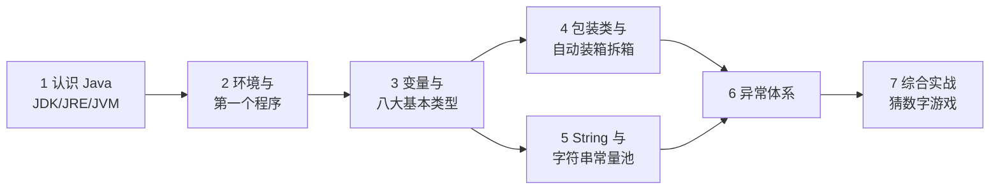
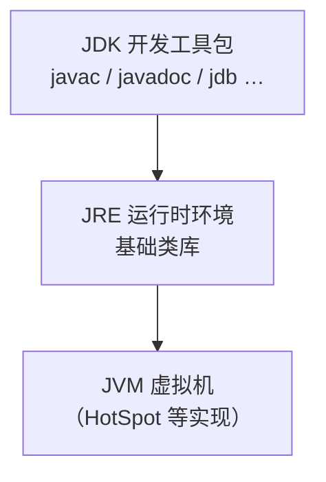
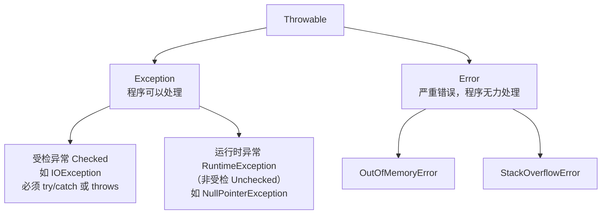

# Java 基础入门：从环境到语法主干

> 📚 **来源与核查**：本篇依据 [JavaGuide《Java 基础常见面试题》上/中/下](https://javaguide.cn/java/basis/java-basic-questions-01.html)（2026-07 更新版）、[Oracle 官方教程 Data Types](https://docs.oracle.com/javase/tutorial/java/nutsandbolts/datatypes.html)、[Oracle try-with-resources 教程](https://docs.oracle.com/javase/tutorial/essential/exceptions/tryResourceClose.html)、[dev.java 官方学习中心](https://dev.java/learn)、[Oracle Java SE 支持路线图](https://www.oracle.com/java/technologies/java-se-support-roadmap.html) 整理，核查日期 **2026-10-25**。示例代码运行环境：Windows 11 + JDK 21（JDK 17/25 亦可，见第 1 节版本说明）。

Java 是一门静态类型、面向对象、编译后再由虚拟机执行的语言。本篇是 java 系列的地基：搭好环境、跑通第一个程序，然后掌握变量与八大基本类型、包装类、String、异常这四块日常代码里出现频率最高的语法主干。完成后你能独立写出带输入输出和异常处理的小控制台程序。

## 🧭 课程地图



一句话路线：先搞清「编译给谁看、谁来执行」（1→2），再按「数据怎么存（3）→ 对象怎么包（4）→ 文本怎么存（5）→ 出错怎么办（6）」推进，最后在实战里串起来（7）。学完本篇接 [02_面向对象.md](02_面向对象.md)。

## 📖 1. 认识 Java：JDK、JRE、JVM 与版本选择

**JVM（Java Virtual Machine，Java 虚拟机）** 运行 Java 字节码的虚拟机，是「一次编译，随处运行」的关键。JVM 是一份规范，有多种实现，HotSpot 只是其中之一（还有 J9、Zing、JRockit 等）。**JRE（Java Runtime Environment，运行时环境）** = JVM + Java 基础类库，只能运行程序；**JDK（Java Development Kit，开发工具包）** = JRE + 编译器 `javac` + `javadoc`、`jdb`、`jconsole`、`javap` 等工具，才能开发程序。三者是包含关系：



两个版本口径（面试常问）：

- **JDK 9 起引入模块系统**，整个 JDK 被组织成 94 个模块，配合 `jlink` 工具可裁剪出最小运行时；**JDK 11 起 Oracle 不再单独提供 JRE**，所以现在装 JDK 就够。
- **LTS（Long-Term Support，长期支持）版本**是生产环境的稳妥选择：8 → 11 → 17 → 21 → 25。截至本篇核查日，最新 LTS 是 **JDK 25**（2025-09-16 发布，含 18 项 JDK 增强提案），最新常规版是 JDK 26（2026-03 发布，非 LTS）。学习/新项目建议直接选 JDK 21 或 25。

> 💡 **技巧｜拿不准公司用哪个版本，先问一句「基线 LTS 是多少」**
> 存量项目大量停留在 8 和 11，新项目多在 17/21。写教程或示例代码时，避开太新的语法就能兼容绝大多数环境——本系列只用各 LTS 通用的语法。

❓ **FAQ**

- **Q：Java 和 JavaScript 是什么关系？** 没有血缘关系，名字相似纯属历史营销。Java 编译成字节码跑在 JVM 上；JavaScript 是浏览器的脚本语言（也能跑在 Node.js 上）。
- **Q：`.java` 文件是怎么变成运行的程序的？** `.java` 源码经 `javac` 编译为 `.class` 字节码文件，再由 JVM 加载执行。字节码不面向具体操作系统，所以同一份 `.class` 能在任何装了 JVM 的系统上跑。

📝 **自测**

1. 🟢 下列哪一组关系是正确的？
   A. JVM ⊃ JRE ⊃ JDK　B. JDK ⊃ JRE ⊃ JVM　C. 三者互相独立
   **答案：B。** 解析：JDK 包含 JRE 和开发工具，JRE 包含 JVM 和类库。新手常把 JVM 当最大的那个（选 A），是因为把「虚拟机」想象成了容纳一切的容器——实际它是被包含的最内层。
2. 🟡 团队新项目应该选哪个 JDK 版本？
   **答案：** 优先当前最新 LTS（核查日为 25），或上一个 LTS（21）。解析：有人会选最新常规版（如 26）图新鲜，但常规版只维护半年，特性也多为预览，不适合生产与学习基线。
3. 🟢 `javac` 和 `java` 命令分别做什么？
   **答案：** `javac` 把 `.java` 源码编译成 `.class` 字节码；`java` 启动 JVM 运行字节码（主类）。

## 🔧 2. 搭建环境并跑通第一个程序

以 Windows 为例（macOS / Linux 流程相同，安装包不同）：

1. 到 [Oracle Java 下载页](https://www.oracle.com/java/technologies/downloads/) 下载 JDK 21 或 25 的 Windows x64 安装包（.msi 或 .exe），按向导安装。
2. 新版安装包通常会自动配置 `PATH`；若第 3 步提示找不到命令，把 JDK 安装目录下的 `bin` 目录手动加入系统 `PATH` 后重开终端。打开终端（PowerShell 或 CMD）验证：

```powershell
java -version     # 应输出 java version "21.x.x" 之类
javac -version    # 应输出 javac 21.x.x
```

3. 新建 `Hello.java`（**文件名必须与 public 类名完全一致**）：

```java
public class Hello {
    public static void main(String[] args) {
        System.out.println("Hello, Java!");
    }
}
```

4. 编译并运行：

```powershell
javac Hello.java    # 生成 Hello.class 字节码
java Hello          # 输出：Hello, Java!
```

> ⚠️ **常见坑｜报错「找不到或无法加载主类 Hello」**
> 现象：`java Hello` 失败。原因：常见有三——运行时把 `.class` 后缀也敲上了（应写 `java Hello` 而不是 `java Hello.class`）；或者在错误的目录下执行（应在 `.class` 所在目录）；或者类声明的包名与目录结构不一致。做法：`dir` 确认 `Hello.class` 就在当前目录，再执行 `java Hello`。

> 💡 **技巧｜只想快速跑单个文件，可以跳过 javac**
> `java Hello.java` 可直接运行单个源码文件（JDK 11+ 的「单文件源码启动器」，JEP 330）。待验证: 该特性正式引入的 JEP 编号与适用边界（本篇未抓取 JEP 原文核实），首次使用前请自行确认你的 JDK ≥ 11。

❓ **FAQ**

- **Q：`main` 方法那一长串 `public static void main(String[] args)` 每个词都是什么意思？** `public` 公开可访问（JVM 要从外部调用它）、`static` 属于类而不需要先建对象、`void` 无返回值、`String[] args` 接收命令行参数。这是 JVM 认定的程序入口签名，写错一个词就「找不到主方法」。
- **Q：为什么每个文件只能有一个 public 类？** Java 规定 public 类名必须与文件名一致，而一个文件只有一个文件名，因此 public 类至多一个；非 public 的类可以写多个，但不推荐。

📝 **自测**

1. 🟢 文件里写着 `public class Demo`，文件名必须是？
   **答案：** `Demo.java`。解析：新手容易以为类名和文件名「差不多就行」，Java 对 public 类是严格相等的强制要求。
2. 🟢 编译成功后，磁盘上多出来的文件是？
   **答案：** `Demo.class`（字节码文件）。

## 📖 3. 变量、八大基本类型与数组

Java 是**静态类型语言**：所有变量必须先声明类型才能使用（Oracle 教程原话："statically-typed ... all variables must first be declared before they can be used"）。类型分两大阵营：**基本类型（primitive type）** 共 8 种，和**引用类型（reference type）**（类、接口、数组等，变量里存的是对象地址）。

| 类型 | 含义 | 位数/字节 | 默认值（字段） | 范围 |
|---|---|---|---|---|
| `byte` | 整数 | 8 / 1 | 0 | −128 ~ 127 |
| `short` | 整数 | 16 / 2 | 0 | −32768 ~ 32767 |
| `int` | 整数 | 32 / 4 | 0 | −2³¹ ~ 2³¹−1 |
| `long` | 整数 | 64 / 8 | 0L | −2⁶³ ~ 2⁶³−1 |
| `char` | 字符 | 16 / 2 | '\u0000' | 0 ~ 65535（16 位 Unicode） |
| `float` | 浮点 | 32 / 4 | 0.0f | IEEE 754 单精度 |
| `double` | 浮点 | 64 / 8 | 0.0d | IEEE 754 双精度 |
| `boolean` | 真/假 | **未精确定义** | false | true / false |

关键细节：

- **boolean 的「大小」没有精确定义**——Oracle 教程原话："This data type represents one bit of information, but its 'size' isn't something that's precisely defined." 面试答「1 位信息、大小未定义」即可。
- **字段有默认值，局部变量没有**：类里不赋值的字段自动取上表默认值；但方法内的局部变量不初始化就用，是**编译期错误**。Oracle 同时提醒：依赖字段默认值被视为坏风格，显式初始化更清晰。
- **字面量写法**：整数默认 `int`，加 `L` 是 `long`（推荐大写 `L`）；浮点默认 `double`，加 `F` 是 `float`；`0x` 十六进制、`0b` 二进制（Java 7+）；数字中间可加下划线增强可读（Java 7+，如 `1234_5678L`，但只能在数字之间，不能在开头结尾、小数点旁或 `F`/`L` 后缀前）。
- **金额永远不要用 float/double**——Oracle 教程明确建议精确值（如货币）用 `java.math.BigDecimal`；`BigDecimal` 比较数值用 `compareTo`，`equals` 会连精度一起比（`0.2` 与 `0.20` 用 `equals` 不相等）。

```java
int gear = 1;                    // 声明并初始化
long id = 1234_5678_9012L;      // 下划线分隔 + L 后缀
double d2 = 1.234e2;            // 科学计数法，等于 123.4
char c = '\u0108';              // Unicode 转义
System.out.println(Integer.toBinaryString(5));  // 101
```

数组（引用类型）固定长度，声明即确定：

```java
int[] scores = new int[3];          // {0, 0, 0}，长度不可再变
scores[0] = 90;
int[] primes = {2, 3, 5, 7};        // 字面量初始化
for (int p : primes) {              // for-each 遍历
    System.out.println(p);
}
System.out.println(primes.length);  // 4，注意 length 是属性不是方法
```

> ⚠️ **常见坑｜ArrayIndexOutOfBoundsException**
> 现象：访问 `primes[4]` 抛异常。原因：数组下标从 0 开始，长度为 4 的合法下标是 0~3；新手常把「长度」当「最后一个下标」用。做法：循环条件用 `i < arr.length`，需要末元素时写 `arr[arr.length - 1]`。

❓ **FAQ**

- **Q：`int` 和 `Integer` 用哪个？** 局部变量、循环计数用 `int`（更快更省）；泛型集合（如 `List<Integer>`）、可为 null 的字段、需要调用工具方法时用 `Integer`。详见第 4 节。
- **Q：移位运算 `x << 42` 是乘 2⁴² 吗？** 不是。JavaGuide 指出 int 移位先对 32 取余，所以 `x << 42` 等同于 `x << 10`；long 则对 64 取余。

📝 **自测**

1. 🟢 下列哪个不是 Java 基本类型？
   A. `char`　B. `String`　C. `boolean`　D. `short`
   **答案：B。** 解析：`String` 是引用类型（类），只是语言给了它字面量写法的特殊照顾。新手选 A 通常是被「字符不是数字」的直觉误导——`char` 确实是 8 种基本类型之一（无符号 16 位整数语义）。
2. 🟡 方法内写 `int x; System.out.println(x);` 会怎样？
   **答案：** 编译错误——局部变量没有默认值。解析：新手常把「字段有默认值」迁移到局部变量上；规则只适用于类字段。
3. 🟡 存「商品价格」应该用什么类型？
   **答案：** `BigDecimal`（精确十进制）。解析：选 `double` 是最典型的新手错误——二进制浮点无法精确表示 0.1 这类十进制小数，累计运算会出误差；Oracle 教程对货币场景明确点名 BigDecimal。
4. 🔴 `new int[3]` 之后 `arr[3] = 1;` 会怎样？
   **答案：** 运行时抛 `ArrayIndexOutOfBoundsException`（编译期不报错）。解析：数组越界是运行时检查，很多人以为编译器能查出来——长度可能是运行时才确定的，编译器无法静态判断。

## 📖 4. 包装类与自动装箱拆箱

每种基本类型都有对应的**包装类（wrapper class）**：`Byte`、`Short`、`Integer`、`Long`、`Character`、`Float`、`Double`、`Boolean`。**自动装箱（autoboxing）**是基本类型 → 包装类的自动转换，**拆箱（unboxing）**是反方向。JavaGuide 从字节码角度给出原理：装箱实际调用 `valueOf()`，拆箱调用 `xxxValue()`（如 `intValue()`）——所以 `Integer i = 10;` 等价于 `Integer i = Integer.valueOf(10);`，频繁装箱拆箱有性能开销，循环里要留意。

**缓存机制**（高频考点）：`Byte`、`Short`、`Integer`、`Long` 缓存 **[-128, 127]** 区间的对象，`Character` 缓存 **[0, 127]**，`Boolean` 直接返回 `TRUE`/`FALSE`；**`Float`、`Double` 没有缓存**。`Integer` 可用 `-XX:AutoBoxCacheMax` 调大缓存上限（下限 -128 固定），其他整型范围固定。由此产生经典陷阱：

```java
Integer a = 127, b = 127;
System.out.println(a == b);   // true：都取缓存里的同一个对象

Integer c = 128, d = 128;
System.out.println(c == d);   // false：超出缓存，各自 new 了新对象
System.out.println(c.equals(d)); // true：值相等

Integer e = new Integer(127); // 与缓存对象比较
System.out.println((Integer)127 == e); // false：缓存对象 vs 新对象
```

> ⚠️ **常见坑｜包装类用 == 比较**
> 现象：`==` 比较包装类时结果「时对时错」（127 对、128 错）。原因：`==` 比较的是引用是否指向同一对象，只有落在缓存区间才碰巧相等。做法：JavaGuide 的建议原话——**「所有整型包装类对象之间值的比较，全部使用 equals 方法比较」**。

基本类型 vs 包装类型四大区别（JavaGuide 总结）：用途上包装类可用于泛型而基本类型不行；存储上基本类型局部变量在栈帧局部变量表、包装类实例通常在堆；默认值上包装类是 `null` 而基本类型有零值；占用空间上基本类型更小。

❓ **FAQ**

- **Q：为什么泛型不能用基本类型（`List<int>` 不行）？** 泛型是编译期检查 + 对象操作，基本类型不是对象；必须用包装类 `List<Integer>`。（自动装箱让你 `add(5)` 时感觉不到差异。）
- **Q：字段用 `int` 还是 `Integer`？** 「没有值」是否是合法状态？是（如数据库可空字段、未填写）→ `Integer`；否 → `int`，还能避免无谓的判空。

📝 **自测**

1. 🟢 `Integer i = 100;` 背后调用的方法是？
   **答案：** `Integer.valueOf(100)`。
2. 🟡 下列代码输出？
   ```java
   Integer x = 1000, y = 1000;
   System.out.println(x == y);
   ```
   **答案：** `false`（1000 超出 [-128,127] 缓存，两个不同对象）。解析：新手以为「都是 1000 当然相等」——`==` 对引用比的是地址，不是值。
3. 🟢 哪两个包装类**没有**缓存机制？
   **答案：** `Float` 和 `Double`。

## 📖 5. String 与字符串常量池

**String 不可变（immutable）**：JavaGuide 指出 String 内部是 final 修饰的字符数组，对象创建后内容不能改；所有「修改」字符串的方法（`replace`、`concat`、`toUpperCase` 等）都是返回新对象。这个设计带来两个直接收益：安全（做 key 不怕被改）与共享——配合**字符串常量池（String Pool）**避免重复创建，池的位置自 **JDK 7 起从永久代移到了堆**中。

三个类的选择（高频考点，JavaGuide 口径）：

| 类 | 可变性 | 线程安全 | 适用场景 |
|---|---|---|---|
| `String` | 不可变 | ——（不可变天然线程安全） | 绝大多数场景 |
| `StringBuffer` | 可变 | 是（方法同步） | 多线程拼接（少见） |
| `StringBuilder` | 可变 | 否 | **单线程拼接首选**，无同步开销，性能最好 |

`String.intern()` 是 native 方法：常量池里有该字符串就返回池中引用，没有就加入池并返回引用——用于复用对象、减少重复字符串占用的内存。

```java
String s = "hello";
String t = new String("hello");
System.out.println(s == t);        // false：t 在堆里 new 了新对象
System.out.println(s.equals(t));   // true：内容相等
System.out.println(s == t.intern()); // true：intern 返回池中 "hello" 的引用

// 循环里这样写会产生大量临时对象：
String bad = "";
for (int i = 0; i < 1000; i++) {
    bad += i;      // 每次都新建对象，改用 StringBuilder
}
StringBuilder sb = new StringBuilder();
for (int i = 0; i < 1000; i++) {
    sb.append(i);  // 在同一对象上追加
}
```

**编码常识**（为 IO 篇打底，源自 JavaGuide IO 篇）：Unicode 是字符集，UTF-8/UTF-16/UTF-32 是它的编码方式；UTF-8 下英文 1 字节、中文通常 3 字节。

> ⚠️ **常见坑｜循环里用 + 拼接字符串**
> 现象：大循环拼接后变慢、内存压力大。原因：String 不可变，每次 `+=` 都生成新对象、复制旧内容。做法：单线程用 `StringBuilder`，多线程共享拼接才考虑 `StringBuffer`。

❓ **FAQ**

- **Q：`String s = new String("abc")` 创建了几个对象？** 常量池中没有 "abc" 时是 2 个（池中字面量 + 堆里 new 的对象）；池中已存在则是 1 个。这道题的意义在于理解「字面量进常量池、new 一定在堆上建对象」。
- **Q：既然 String 不可变，为什么我能 `s = s + "!"`？** 你改的是变量 `s` 的指向（指向了新对象），原对象内容没变。不可变说的是对象，不是变量。

📝 **自测**

1. 🟢 单线程循环拼接大量字符串，应该用哪个类？
   **答案：** `StringBuilder`。解析：选 `StringBuffer` 的新手是记住了「它线程安全」，但单线程下同步是纯开销。
2. 🟡 `String a = "java"; String b = "ja" + "va"; System.out.println(a == b);` 输出？
   **答案：** `true`——两个字面量拼接在编译期已确定为 "java"，进同一常量池条目。（若 b 由变量拼接而来则结果不同，指向堆中新对象。）
3. 🔴 字符串常量池在 JDK 7 之后位于哪个内存区域？
   **答案：** 堆（从永久代移出，便于随普通 GC 及时回收）。解析：答「方法区/永久代」是常见过时口径——详见 [06_jvm.md](06_jvm.md) 第 3 节。

## 📖 6. 异常体系

Java 所有异常与错误的共同祖先是 `java.lang.Throwable`，它有两个重要子类（JavaGuide 口径）：



- **Exception**：程序本身可以处理的异常。其中编译器强制处理的叫**受检异常（Checked Exception）**，不处理编译不过；`RuntimeException` 及其子类是**非受检异常（Unchecked Exception）**，如 `NullPointerException`、`ArrayIndexOutOfBoundsException`，通常靠改代码避免而非捕获。
- **Error**：严重错误（如 `OutOfMemoryError`、`StackOverflowError`），程序无法处理，不应试图捕获。

处理语法：`try`/`catch`/`finally`——`finally` 块无论是否异常都会执行（用于清理资源）；JDK 7+ 推荐 **try-with-resources**：把实现了 `AutoCloseable` 的资源声明在 `try(...)` 括号里，语句结束时**自动关闭每个资源**（Oracle 教程口径），不必手写 `finally { res.close() }`：

```java
import java.io.BufferedReader;
import java.io.FileReader;
import java.io.IOException;

try (BufferedReader br = new BufferedReader(new FileReader("data.txt"))) {
    System.out.println(br.readLine());
} catch (IOException e) {
    System.err.println("读取失败：" + e.getMessage());
}
// 无需 finally：br 已自动 close
```

> ⚠️ **常见坑｜catch (Exception e) 一把梭**
> 现象：图省事捕获最宽的 `Exception`，把本该暴露的 bug（空指针、越界）也吞掉。原因：受检异常逼你处理，新手就挑最宽的类型。做法：只捕获你能处理的类型；处理不了就往上抛（`throws`），或转成有意义的状态（返回错误码 / 抛自定义异常）。

❓ **FAQ**

- **Q：`finally` 一定执行吗？** 正常流程、异常流程、甚至 `try` 里 `return` 了都会执行；极端情况除外（如 JVM 直接退出 `System.exit()`）。
- **Q：受检和非受检怎么快速区分？** 看编译器：不 try/catch 也不 throws 就编译不过的是受检（如 `IOException`）；编译器不管、运行时才炸的是非受检（`RuntimeException` 家族）。
- **Q：`throw` 和 `throws` 的区别？** `throw` 在方法体内抛出一个异常对象；`throws` 在方法签名上声明「本方法可能抛出这些异常」，交给调用者处理。

📝 **自测**

1. 🟢 `NullPointerException` 属于？
   **答案：** 运行时异常（非受检异常），继承自 `RuntimeException`。解析：选「受检异常」的新手是把「编译器提醒我」和「编译器强制我」混为一谈——NPE 从不提醒，直接在运行时炸。
2. 🟡 try-with-resources 的资源需要实现哪个接口，语句结束时会发生什么？
   **答案：** `AutoCloseable`（流的父接口 `Closeable` 是其子接口）；按声明顺序自动调用 `close()`。
3. 🟡 `Error` 应该被捕获处理吗？
   **答案：** 不应该，如 `OutOfMemoryError` 程序已无力恢复，捕获它只会掩盖问题；应从参数调优 / 代码层面解决（见 [06_jvm.md](06_jvm.md)）。

## 🚀 7. 综合实战：猜数字游戏

综合运用：类型与运算（第 3 节）、包装类与解析（第 4 节）、String（第 5 节）、异常处理（第 6 节）。程序随机生成 1~100 的数，用户循环输入猜测，给「大了/小了」提示，输入非数字时用异常处理优雅重试。

```java
import java.util.Random;
import java.util.Scanner;

public class GuessNumber {
    public static void main(String[] args) {
        int answer = new Random().nextInt(100) + 1;  // 1~100
        Scanner sc = new Scanner(System.in);
        int tries = 0;
        System.out.println("我想好了 1~100 的一个数，猜猜看：");
        while (true) {
            String line = sc.nextLine().trim();      // 读原始行，自己解析
            int guess;
            try {
                guess = Integer.parseInt(line);      // 非数字会抛 NumberFormatException
            } catch (NumberFormatException e) {
                System.out.println("「" + line + "」不是数字，请重新输入：");
                continue;
            }
            tries++;
            if (guess < 1 || guess > 100) {
                System.out.println("请输入 1~100 之间的数：");
            } else if (guess < answer) {
                System.out.println("小了，再猜：");
            } else if (guess > answer) {
                System.out.println("大了，再猜：");
            } else {
                System.out.println("猜中了！答案就是 " + answer + "，共用了 " + tries + " 次。");
                break;
            }
        }
    }
}
```

运行（Windows，JDK 21）：

```powershell
javac GuessNumber.java
java GuessNumber
```

练习扩展：① 记录每局成绩到 `StringBuilder`，结束时统一打印历史；② 限制最多 7 次机会（提示：二分策略 7 次必中）；③ 把 `Integer.parseInt` 换成自己写的解析方法，抛出自定义的 `IllegalArgumentException`。

## 📚 8. 来源与进一步学习

- [JavaGuide：Java 基础常见面试题总结（上）](https://javaguide.cn/java/basis/java-basic-questions-01.html)（JVM/JDK/JRE、基本类型表、装箱拆箱、缓存、重载重写）／[（中）](https://javaguide.cn/java/basis/java-basic-questions-02.html)（String 三姊妹、接口与抽象类）／[（下）](https://javaguide.cn/java/basis/java-basic-questions-03.html)（异常体系）——核查 2026-10-25
- [Oracle The Java Tutorials：Data Types](https://docs.oracle.com/javase/tutorial/java/nutsandbolts/datatypes.html)（八种类型、字面量、BigDecimal 建议）——核查 2026-10-25
- [Oracle：try-with-resources](https://docs.oracle.com/javase/tutorial/essential/exceptions/tryResourceClose.html)——核查 2026-10-25
- [dev.java 官方学习中心](https://dev.java/learn)（Oracle 新版官方教程，First Steps / Language Basics 路线）——核查 2026-10-25
- [Oracle Java SE 支持路线图](https://www.oracle.com/java/technologies/java-se-support-roadmap.html)（LTS 版本口径）／[Java 25 发布公告](https://www.oracle.com/cn/news/announcement/oracle-releases-java-25-2025-09-16)——核查 2026-10-25
- 下一篇：[02_面向对象.md](02_面向对象.md)；刷算法时的集合速查见 [algorithms 基础篇](../algorithms/01_basics.md)
