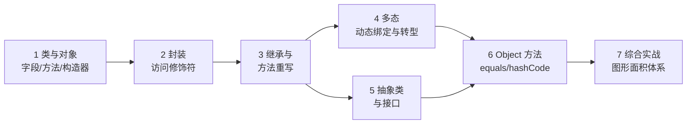

# Java 面向对象：从类到多态

> 📚 **来源与核查**：本篇依据 [JavaGuide《Java 基础常见面试题》](https://javaguide.cn/java/basis/java-basic-questions-01.html)（重载与重写口径，2026-07 版）、[JavaGuide（中）：接口与抽象类](https://javaguide.cn/java/basis/java-basic-questions-02.html)、[Object 类官方 Javadoc（Java SE 21）](https://docs.oracle.com/en/java/javase/21/docs/api/java.base/java/lang/Object.html)、[Oracle 官方教程 Learning the Java Language](https://docs.oracle.com/javase/tutorial/java/index.html)、[dev.java 学习中心](https://dev.java/learn) 整理，核查日期 **2026-10-25**。示例环境：Windows 11 + JDK 21。

面向对象（Object-Oriented Programming，OOP）是 Java 的骨架：把数据与操作它的方法打包成**类（class）**，程序运行时用类创建**对象（object）**。本篇讲清三大特性（封装、继承、多态）、抽象类与接口的取舍、以及 `equals`/`hashCode` 这对最容易写错的 Object 方法。完成后你能设计出可扩展的类层次，并在面试里讲明白「重载与重写」「接口与抽象类」两组高频对比。

前置：[01_基础入门.md](01_基础入门.md)（类型、方法、String）。

## 🧭 课程地图



一句话路线：先会「造类」（1→2），再学「类与类的关系」（3→5），多态是继承的收益（4），最后落到每个类都绕不开的 Object 方法（6）并用一个图形体系串起来（7）。

## 📖 1. 类与对象：字段、方法、构造器

类是模板，对象是实例。最简的类包含三样东西：

```java
public class Student {
    // 字段（field / 成员变量）：对象的数据
    private String name;
    private int score;

    // 构造器（constructor）：与类同名、无返回类型，用于创建对象时初始化
    public Student(String name, int score) {
        this.name = name;      // this 指代「当前正在构造的对象」
        this.score = score;
    }

    // 无参构造器：一旦手写任何构造器，编译器不再默认提供，需要就显式写出
    public Student() {
        this("匿名", 0);        // this(...) 调用另一个构造器，必须在本构造器第一行
    }

    // 方法（method）：对象的行为
    public void printInfo() {
        System.out.println(name + "：" + score + " 分");
    }
}

// 使用
Student s = new Student("小张", 92);  // new 在堆上创建对象并调用构造器
s.printInfo();
```

**`static`（静态）**：属于类而不属于单个对象。静态字段全类共享一份（如计数器），静态方法可直接用类名调用（如 `Math.max`、`Integer.parseInt`），因此它内部不能使用实例字段——没有「当前对象」可用。`main` 之所以是 static，就是因为 JVM 启动时还没有任何对象可依附。

**重载（overload）**：同一个类里方法名相同、**参数列表必须不同**（类型、个数或顺序），与返回值和访问修饰符无关，**编译期**按参数静态匹配。比如 `Math.abs` 有 `int`、`long`、`float`、`double` 四个重载版本。

❓ **FAQ**

- **Q：成员变量（字段）和局部变量什么区别？** 位置与生命周期不同：字段在类内、堆中随对象存活，有默认值；局部变量在方法内、栈上随方法调用结束而消失，无默认值（见 [01_基础入门.md](01_基础入门.md) 第 3 节）。
- **Q：一个类可以有多少个构造器？** 多个，参数列表互不相同（重载）。但注意 `this(...)` 链不能成环。

📝 **自测**

1. 🟢 构造器的名字和返回类型是？
   **答案：** 与类同名，**没有**返回类型（连 void 都不写）。解析：写成 `public void Student()` 的新手得到的是一个普通方法而非构造器——编译不报错，但对象初始化不会走它，极难排查。
2. 🟡 static 方法里能直接使用实例字段吗？为什么？
   **答案：** 不能。静态方法属于类，调用时可能根本不存在任何对象实例，没有 `this` 可指。
3. 🟢 下列哪组可以构成重载？
   A. `int add(int a, int b)` 与 `double add(int a, int b)`　B. `add(int a)` 与 `add(int a, int b)`　C. `add(int a)` 与 `sub(int a)`
   **答案：B。** 解析：选 A 的新手以为「返回类型不同就算不同」——重载只看参数列表；C 是两个不同方法名，谈不上重载。

## 📖 2. 封装：访问修饰符

**封装（encapsulation）**：把字段藏起来（`private`），只通过公开方法暴露受控的访问与修改。好处：字段赋值可以加校验，内部实现可以随时改而不影响调用方。

```java
public class Account {
    private double balance;              // 外部不可直接访问

    public double getBalance() {         // 读：getter
        return balance;
    }

    public void deposit(double amount) { // 写：带校验的 setter 风格方法
        if (amount <= 0) {
            throw new IllegalArgumentException("存款金额必须为正数：" + amount);
        }
        this.balance += amount;
    }
}
```

四种访问修饰符，从窄到宽：`private`（本类）→ 默认/包级私有（同包，不写修饰符）→ `protected`（同包 + 其他包的子类）→ `public`（任意位置）。顶层类只能用 public 或默认；成员四选一。

> 💡 **技巧｜默认值给字段、`private` 给字段、`public` 给方法**
> 经验法则：字段一律 private（或 protected 供子类），通过方法访问；这是标准库源码里随处可见的风格，也是「封装」二字的落地动作。

> ⚠️ **常见坑｜字段 public 导致校验被绕过**
> 现象：`public double balance` 被外部一句 `acc.balance = -999` 改坏。原因：字段直接暴露，任何校验代码都形同虚设。做法：字段改 private，把「怎么改」收进方法里。

❓ **FAQ**

- **Q：getter/setter 一定要成对生成吗？** 不必。只读字段就只给 getter（如余额通常只读，修改走 deposit/withdraw 这类有业务含义的方法）。
- **Q：不写修饰符是什么级别？** 包级私有（package-private）：同一个包里随便访问，包外不行——常用于包内协作的「半公开」成员。

📝 **自测**

1. 🟢 希望字段「本类可访问、子类可访问、无血缘的类不可访问」，选哪个修饰符？
   **答案：** `protected`。解析：选 `private` 的新手忽略了「子类也要访问」这一条件；选默认（包级）则在「不同包的子类」场景失效。
2. 🟢 封装的核心动作是什么？
   **答案：** 字段私有化 + 通过公开方法提供受控访问（可校验、可撤销、可换实现）。

## 📖 3. 继承与方法重写

**继承（inheritance）**用 `extends` 表达 is-a 关系：子类自动获得父类的字段和方法，并可扩展或改写。Java **单继承**：一个类只能有一个直接父类（`Object` 是所有类的祖先）。

```java
public class Animal {
    protected String name;
    public Animal(String name) { this.name = name; }
    public void makeSound() { System.out.println(name + " 发出声音"); }
}

public class Dog extends Animal {
    public Dog(String name) {
        super(name);          // 调用父类构造器，必须在子类构造器第一行
    }

    @Override                 // 重写注解：编译器帮你核对签名是否真的重写成功
    public void makeSound() { // 方法重写（override）
        super.makeSound();    // super. 调用父类版本（可选）
        System.out.println(name + " 汪汪");
    }
}
```

**重写（override）**的规则，JavaGuide 总结为「**两同两小一大**」：方法名、形参列表**相同**；返回值与抛出异常**相同或更小**（返回值为子类型、异常范围更窄）；访问权限**更大或相等**。对比记忆：

| 维度 | 重载 Overload | 重写 Override |
|---|---|---|
| 发生范围 | 同一个类中 | 父类与子类之间 |
| 方法签名 | 名同、参数列表**必须不同** | 名、参数**必须完全相同** |
| 返回类型 | 无关 | 相同或为其子类 |
| 访问修饰符 | 无关 | 子类不能比父类更严格 |
| 绑定时期 | **编译期**（静态绑定） | **运行期**（动态绑定） |

三条硬约束（JavaGuide）：构造方法不能被重写；`private`、`final`、`static` 方法不能被子类重写（static 方法只能「隐藏」而非重写）；用 `@Override` 注解可以在编译期就发现「本来想重写、签名却写错了」的事故。`final` 修饰类则不可继承、修饰方法则不可重写。

> ⚠️ **常见坑｜重写时参数写错，变成了重载**
> 现象：给 `@Override` 的方法多加了个参数，或参数类型写成 `Object` 而父类是 `String`，编译器报错；若没写 `@Override`，则静默变成一个新方法，父类逻辑照跑。原因：重写要求签名严格相同。做法：重写方法一律标 `@Override`，让编译器当裁判。

❓ **FAQ**

- **Q：子类构造器为什么「必须」先调 `super(...)`？** 子类对象里包含一个父类部分，得先把它初始化好。你不写 `super(...)`，编译器自动插入无参的 `super()`——父类若没有无参构造器就编译失败。
- **Q：继承和组合怎么选？** is-a 用继承（狗是动物），has-a 用组合（汽车有引擎）。滥用继承会造成强耦合，「能用组合就优先组合」是常见工程经验。

📝 **自测**

1. 🟡 父类方法签名 `protected Number calc(String s)`，下列哪个子类重写**非法**？
   A. `public Integer calc(String s)`　B. `protected Double calc(String s)`　C. `private BigDecimal calc(String s)`
   **答案：C。** 解析：访问权限变小违反「一大」。A、B 合法：返回类型 Number 的子类属于「更小」。选 B 的同学若认为「Double 换成别的类型不行」，混淆的是「更小」指子类型关系而非「换成子类都行」——Integer/Double 都是 Number 的子类，都合法。
2. 🟢 能否重写构造方法？
   **答案：** 不能。构造方法属于类创建流程，名字都不同（子类构造器名是子类名），JavaGuide 明确「构造方法无法被重写」。
3. 🔴 `static` 方法父子同名同签名，算重写吗？
   **答案：** 不算，是「隐藏」（静态方法随引用的**编译类型**静态绑定，没有动态绑定）。

## 📖 4. 多态：动态绑定与转型

**多态（polymorphism）**：同一个调用，运行时按**对象的实际类型**执行对应版本。前提是「父类引用指向子类对象」：

```java
Animal a = new Dog("旺财");  // 向上转型（upcasting）：安全的，天然合法
a.makeSound();               // 运行时执行 Dog 的版本——动态绑定

// Dog d = a;                // 编译错：Animal 引用不能直接赋给 Dog
Dog d = (Dog) a;             // 向下转型（downcasting）：需显式强转
d.makeSound();

if (a instanceof Dog) {      // 转型前先判断，养成习惯
    ((Dog) a).fetch();       // 调用 Dog 独有的方法
}
```

要点：

- **编译看左边，运行看右边**：编译器按引用的静态类型（`Animal`）检查「有没有这个方法」；运行期按对象实际类型（`Dog`）决定执行哪个版本。
- 多态的收益：新增子类不改调用代码——方法参数声明为父类/接口，就能接收未来任何新子类（开闭思想的雏形，详见 [07_设计模式.md](07_设计模式.md)）。
- 向下转型失败（实际类型不符）运行时抛 `ClassCastException`，转型前用 `instanceof` 判断。

> ⚠️ **常见坑｜多态调用「子类独有字段/方法」编译不过**
> 现象：`Animal a = new Dog(...)` 后写 `a.fetch()` 编译报错。原因：编译器只认 `Animal` 这个静态类型，`fetch()` 不在 `Animal` 里。做法：要么把方法上提到父类/接口，要么先 `instanceof` 再向下转型。

❓ **FAQ**

- **Q：多态和重载是一回事吗？** 不是。重载是编译期按参数选方法（静态绑定），多态是运行期按对象实际类型选重写版本（动态绑定）——正好对应上表「绑定时期」一行。
- **Q：字段有多态吗？** 没有。字段访问按引用的**编译类型**解析（静态绑定）；只有实例方法才有动态绑定。

📝 **自测**

1. 🟢 `Animal a = new Dog(); a.makeSound();` 执行哪个版本？
   **答案：** `Dog` 的重写版本（运行期动态绑定到实际类型）。
2. 🟡 什么时候必须向下转型？
   **答案：** 需要调用「子类独有」的成员，而手上只有父类引用时；转型前先 `instanceof` 判断。
3. 🟡 多态三要素？
   **答案：** 继承（或接口实现）+ 方法重写 + 父类/接口引用指向子类对象。

## 📖 5. 抽象类与接口

**抽象类（abstract class）**是不能被实例化的类，可包含抽象方法（只有声明没有实现）与完整实现；**接口（interface）**是行为的契约，类用 `implements` 实现接口（可同时实现多个）。JavaGuide 给出的对比（2026-07 版口径）：

- **共同点**：都不能被实例化；都可以包含抽象方法；都用于定义规范。
- **区别**：接口主要用于**定义行为规范**（can-do / has-a 关系），抽象类主要用于**代码复用**、强调 is-a 所属关系；**一个类只能继承一个抽象类，但可以实现多个接口**。接口无构造方法，抽象类有构造方法（供子类 `super()` 调用）。

```java
public abstract class Shape {              // 抽象类：模板 + 部分实现
    protected String name;
    public Shape(String name) { this.name = name; }

    public abstract double area();        // 抽象方法：子类必须实现

    public void describe() {              // 具体方法：子类直接复用
        System.out.println(name + " 的面积是 " + area());
    }
}

public interface Scalable {               // 接口：能力契约
    void scale(double factor);
}

public class Circle extends Shape implements Scalable {  // 单继承 + 多实现
    private double r;
    public Circle(double r) {
        super("圆");
        this.r = r;
    }
    @Override public double area() { return Math.PI * r * r; }
    @Override public void scale(double factor) { r *= factor; }
}
```

> 💡 **技巧｜选型口诀：模板复用选抽象类，能力契约选接口**
> 需要在相关类间**共享代码和公共状态**（字段、构造器、部分实现）→ 抽象类；需要定义**行为规范**、让不相关的类都具备同一能力、或需要多继承效果 → 接口。两者还能组合（如上例）。

补充：接口方法默认就是抽象的；JDK 8 起接口还可包含带实现的 `default` 方法（JavaGuide 类加载篇在讲初始化时机时也提及「接口含 default 方法」的场景）。

❓ **FAQ**

- **Q：抽象类可以没有抽象方法吗？** 可以——只要被 `abstract` 修饰就无法实例化；常见于「纯挡实例化」的工具基类。
- **Q：接口里能写字段吗？** 接口中的字段隐式为 `public static final`（常量）。接口承载的是行为契约，不要把它当常量仓库滥用。

📝 **自测**

1. 🟢 一个类能继承几个抽象类、实现几个接口？
   **答案：** 最多继承 1 个抽象类，可实现多个接口。解析：Java 单继承多实现；选「多个抽象类」的新手把接口的多实现错套到了继承上。
2. 🟡 场景：`Bird`、`Plane` 都要「能飞」，但两者毫无血缘。用抽象类还是接口？
   **答案：** 接口（如 `Flyable`）。解析：can-do 关系选接口；用抽象类强迫它们共出一个父类，是「为复用而复用」的反例。
3. 🟡 「接口主要用于定义行为规范，抽象类主要用于代码复用」分别对应什么关系？
   **答案：** can-do（has-a 能力）与 is-a（所属）。

## 📖 6. Object 核心方法与相等性

每个类都隐式继承 `Object`，四个最该掌握的方法（契约摘自官方 Javadoc，Java SE 21）：

- **`equals(Object obj)`**：默认就是 `==`（同一对象才相等）。重写后必须满足等价关系：自反（`x.equals(x)` 为 true）、对称、传递、一致，且 `x.equals(null)` 返回 false。
- **`hashCode()`**：一致性（同一次运行中对同一对象反复调用结果相同）；**「equals 相等的两个对象必须有相等的 hashCode」**——这是铁律，反了不要求（不相等的对象允许撞哈希，但散列效果差）。
- **`toString()`**：默认返回 `getClass().getName() + '@' + Integer.toHexString(hashCode())`，Javadoc 建议所有子类重写。
- **`getClass()`**：返回运行时类对象，`final` 不可重写。

```java
import java.util.Objects;

public class Point {
    private final int x;
    private final int y;
    public Point(int x, int y) { this.x = x; this.y = y; }

    @Override
    public boolean equals(Object o) {
        if (this == o) return true;                 // 自查：同一对象直接 true
        if (!(o instanceof Point)) return false;    // 含 null 判断：null 时为 false
        Point p = (Point) o;
        return x == p.x && y == p.y;
    }

    @Override
    public int hashCode() {
        return Objects.hash(x, y);                  // 与 equals 用同一批字段
    }

    @Override
    public String toString() { return "(" + x + ", " + y + ")"; }
}
```

> ⚠️ **常见坑｜只重写 equals 不重写 hashCode**
> 现象：两个「相等」的对象放进 `HashSet`/`HashMap` 后行为诡异——查不到、重复出现。原因：哈希容器先按 hashCode 分桶再在桶内用 equals 比较；equals 相等而 hashCode 不同，两个对象落进不同桶，等价于「不相等」。做法：equals 用了哪些字段，hashCode 就基于同一批字段计算（`Objects.hash(...)` 最省事）。HashMap 的原理见 [03_集合框架.md](03_集合框架.md)。

顺带两个现代语法点：**枚举（enum）**是天生单例的常量集合（`enum Status { ACTIVE, CLOSED }`，自动获得 `values()`、`name()`，可直接用于 switch）；**record** 是 JDK 16+ 为「纯数据载体」准备的紧凑写法，一行 `record Point(int x, int y) {}` 自动生成构造器、`equals`/`hashCode`/`toString`。待验证: record 正式转正的版本号与 `equals` 生成细节（本篇未抓官方页面核实，使用前请查阅 [dev.java](https://dev.java/learn) 或 Javadoc）。

❓ **FAQ**

- **Q：`==` 和 `equals` 的区别？** `==` 对基本类型比值，对引用类型比地址；`equals` 默认同比地址，重写后按内容比（String、Integer 等都已重写）。
- **Q：为什么 `equals` 参数必须是 `Object` 而不能是 `Point`？** 参数写成 `Point` 就变成了重载而非重写，集合框架按 `Object` 版本调用时不会走到你的方法。

📝 **自测**

1. 🟡 equals 相等的两个对象，hashCode 必须如何？
   **答案：** 必须相等（Javadoc 原话 "equal objects must have equal hash codes"）。解析：答「可以不同」的新手把「不相等对象允许同 hashCode」的宽松条款用反了方向。
2. 🟢 `Object.toString()` 默认输出格式是？
   **答案：** `类全名 + '@' + hashCode 的十六进制`。
3. 🔴 把自定义类放入 HashMap 后 get 不到，第一反应查什么？
   **答案：** 该类是否正确重写了 `equals` 与 `hashCode` 且两者基于同一批字段。

## 🚀 7. 综合实战：图形面积体系

贯通本篇六节：抽象类 + 接口 + 继承 + 多态 + Object 方法。实现一个图形体系，能多态计算面积、按能力缩放、按内容比较相等。

```java
import java.util.ArrayList;
import java.util.List;
import java.util.Objects;

interface Scalable {                       // 第 5 节：能力契约
    void scale(double factor);
}

abstract class Shape {                     // 第 5 节：模板复用
    protected final String name;
    protected Shape(String name) { this.name = name; }
    public abstract double area();         // 留给子类实现
    public void describe() {               // 第 4 节：多态调用 area()
        System.out.printf("%s 面积 = %.2f%n", name, area());
    }
}

class Circle extends Shape implements Scalable {
    private double r;
    Circle(double r) { super("圆"); this.r = r; }
    @Override public double area() { return Math.PI * r * r; }
    @Override public void scale(double f) { r *= f; }
    @Override public boolean equals(Object o) {
        if (this == o) return true;
        if (!(o instanceof Circle)) return false;
        return Double.compare(((Circle) o).r, r) == 0;   // double 用 compare，不用 ==
    }
    @Override public int hashCode() { return Objects.hash(r); }
    @Override public String toString() { return "Circle{r=" + r + "}"; }
}

class Rect extends Shape implements Scalable {
    private final double w, h;
    Rect(double w, double h) { super("矩形"); this.w = w; this.h = h; }
    @Override public double area() { return w * h; }
    @Override public void scale(double f) { /* 本例演示只读形状，缩放略 */ }
}

public class ShapeDemo {
    public static void main(String[] args) {
        List<Shape> shapes = new ArrayList<>();        // 第 4 节：父类引用装子类对象
        shapes.add(new Circle(2));
        shapes.add(new Rect(3, 4));

        double total = 0;
        for (Shape s : shapes) {                       // 多态：同一调用不同实现
            s.describe();
            total += s.area();
        }
        System.out.printf("总面积 = %.2f%n", total);

        Circle c1 = new Circle(2), c2 = new Circle(2);
        System.out.println(c1.equals(c2));   // true：内容相等
        System.out.println(c1 == c2);        // false：两个对象
    }
}
```

练习扩展：① 给 `Shape` 加 `perimeter()` 抽象方法；② 新增 `Triangle`，体会「加子类不改 main」的开闭效果；③ 把 `Circle.equals` 中的 `Double.compare` 换成 `==` 试试 `r = 0.1 + 0.2` 时会发生什么（回看 [01_基础入门.md](01_基础入门.md) 的浮点坑）。

## 📚 8. 来源与进一步学习

- [JavaGuide：Java 基础常见面试题（上）](https://javaguide.cn/java/basis/java-basic-questions-01.html)（重载 vs 重写表、两同两小一大、构造器与 static 约束）／[（中）](https://javaguide.cn/java/basis/java-basic-questions-02.html)（接口 vs 抽象类、String 三姊妹）——核查 2026-10-25
- [Object（Java SE 21 Javadoc）](https://docs.oracle.com/en/java/javase/21/docs/api/java.base/java/lang/Object.html)（equals 五条契约、hashCode 铁律、toString 默认格式）——核查 2026-10-25
- [Oracle：Learning the Java Language](https://docs.oracle.com/javase/tutorial/java/index.html)（类与对象、继承与接口的经典教程）／[dev.java 学习中心](https://dev.java/learn)——核查 2026-10-25
- 下一篇：[03_集合框架.md](03_集合框架.md)；面向对象在设计模式的落地见 [07_设计模式.md](07_设计模式.md)
