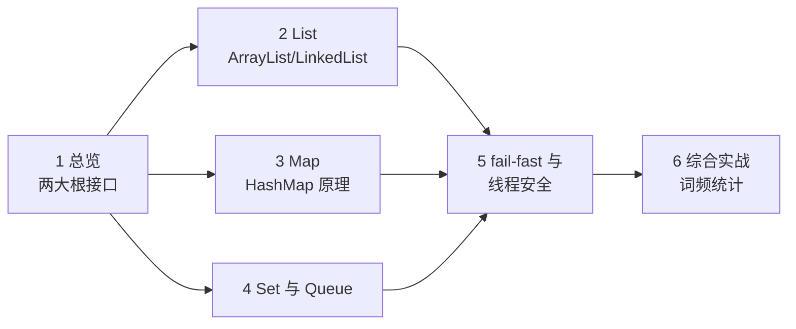
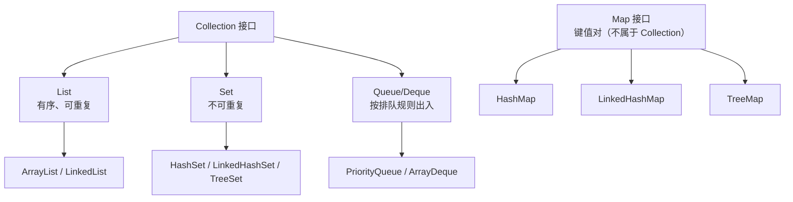
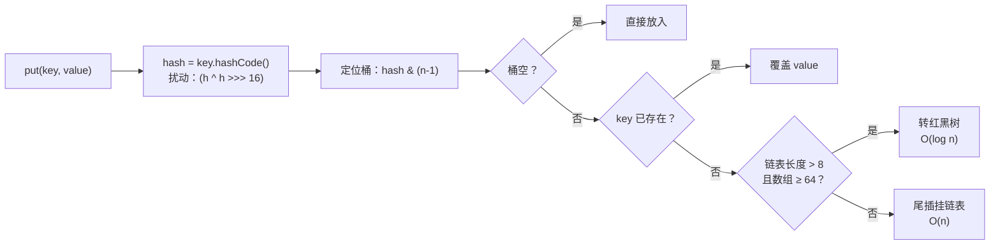

# Java 集合框架：List、Set、Map 与 Queue

> 📚 **来源与核查**：本篇依据 [JavaGuide《Java 集合常见面试题》上/下](https://javaguide.cn/java/collection/java-collection-questions-01.html)（2026-06 版）、[JavaGuide《ArrayList 扩容机制分析》](https://javaguide.cn/java/collection/arraylist-source-code.html)、[HashMap 官方 Javadoc（Java SE 21）](https://docs.oracle.com/en/java/javase/21/docs/api/java.base/java/util/HashMap.html) 整理，核查日期 **2026-10-25**。示例环境：Windows 11 + JDK 21。

数组长度固定、功能单一，集合框架（Collections Framework）就是 Java 官方的「数据结构工具箱」：动态长度的列表、自动去重的集合、按键查找的映射、按序排队的队列。本篇吃透四类容器的选型逻辑与两个高频深水区（ArrayList 扩容、HashMap 原理），完成后你能回答集合方向绝大多数面试题，也能在日常代码里做对选型。

前置：[01_基础入门.md](01_基础入门.md)、[02_面向对象.md](02_面向对象.md)（接口与多态）。

## 🧭 课程地图



一句话路线：先建全局地图（1），再按使用频率深入四类容器（2~4），第 5 节统一讲并发修改这组共性坑，最后实战里做一次真实的 Map 选型决策（6）。复杂度速查另见 [algorithms 基础篇](../algorithms/01_basics.md)。

## 📖 1. 总览：两大根接口

JavaGuide 给出的顶层划分：**Collection 存单一元素**，下有 List、Set、Queue 三个主要子接口；**Map 存键值对**，独立于 Collection 体系。



四类容器的核心约定（JavaGuide 口径）：**List** 元素有序、可重复；**Set** 元素不可重复；**Queue** 按排队规则确定先后，元素有序可重复；**Map** 的 key 无序不可重复、value 可重复（HashMap 等无序；LinkedHashMap、TreeMap 分别靠双向链表、红黑树维护顺序）。

使用时一律带**泛型（generics）**类型参数——尖括号里声明元素类型，编译器帮你把「放错东西」拦在编译期：

```java
List<String> names = new ArrayList<>();   // 只能放 String
names.add("Java");
// names.add(42);  // 编译错误，提前暴露问题
Map<String, Integer> scores = new HashMap<>();
scores.put("语文", 92);                     // key 是 String，value 是 Integer（自动装箱）
```

> 💡 **技巧｜预估容量能少踩扩容**
> 知道大概要装多少元素时，`new ArrayList<>(10_000)`、`HashMap.newHashMap(10_000)`（JDK 19+，Javadoc 推荐）在创建时就按预期规模分配，避免反复扩容拷贝。原理见第 2、3 节。

❓ **FAQ**

- **Q：为什么 `List<int>` 不行、必须写 `List<Integer>`？** 泛型只接受引用类型，基本类型要靠自动装箱进包装类（见 [01_基础入门.md](01_基础入门.md) 第 4 节）。
- **Q：数组和 List 怎么选？** 长度固定、追求极致性能用数组；需要动态增删、丰富 API 用集合。`Arrays.asList` 的桥梁用法见 [08_常用工具类.md](08_常用工具类.md)。

📝 **自测**

1. 🟢 存「学号 → 学生」的对应关系，选哪类容器？
   **答案：** Map（键值对）。解析：选 List 的新手会用「两个平行 List 按下标对齐」，任何插入删除都会让两表错位。
2. 🟢 Map 属于 Collection 体系吗？
   **答案：** 不属于，Map 是独立的根接口（存的是键值对而非单一元素）。
3. 🟡 哪两个 Map 实现能保证遍历顺序？各靠什么？
   **答案：** LinkedHashMap（双向链表，插入序或访问序）、TreeMap（红黑树，按 key 大小序）。

## 📖 2. List：ArrayList 与 LinkedList

两大实现的所有关键差异都源于底层结构（JavaGuide + 源码分析篇口径）：

| 维度 | `ArrayList` | `LinkedList` |
|---|---|---|
| 底层结构 | `Object[]` 数组 | 双向链表（JDK 1.7 起取消循环） |
| 随机访问 | O(1)，实现了 `RandomAccess` 标记接口 | O(n)，无 RandomAccess |
| 头部插入/删除 | O(n)（整体搬移） | O(1) |
| 尾部追加 | 均摊 O(1)（触发扩容则 O(n)） | O(1) |
| 中间插删 | O(n) | O(n)（先遍历定位；平均遍历约 n/4，有头尾指针可两头找） |
| 额外空间 | 末尾预留空闲容量 | 每个节点多存前驱、后继两个指针 |
| 线程安全 | 否 | 否 |

**ArrayList 扩容机制**（源码分析，高频考点）：

- 默认初始容量常量 `DEFAULT_CAPACITY = 10`，但无参构造初始只赋**空数组**——**添加第一个元素时才真正分配 10 个容量**。
- 扩容在 `grow()` 中完成：`int newCapacity = oldCapacity + (oldCapacity >> 1);`——新容量约为旧的 **1.5 倍**（偶数正好，奇数因整数运算略少，如 33→49）。
- 上限常量 `MAX_ARRAY_SIZE = Integer.MAX_VALUE - 8`，超过后走 `hugeCapacity()` 仲裁，仍不够抛 `OutOfMemoryError`。
- 扩容靠 `Arrays.copyOf` 整体复制（内部 `System.arraycopy`）——所以「预估容量」才值得做。

JavaGuide 的选型结论：**一般项目直接用 ArrayList**，绝大多数场景（含随机访问、甚至尾部追加为主的插删）性能更好；LinkedList 只在「频繁头尾操作且几乎不随机访问」时才有优势。另一个老牌实现 `Vector` 虽线程安全，但同步开销大，JavaGuide 标注其已淘汰，需要线程安全看第 5 节。

```java
List<String> list = new ArrayList<>();
list.add("a");
list.add(0, "b");          // 头部插入，后面元素整体后移
list.set(0, "c");          // 替换
list.remove("a");          // 按内容删第一个匹配
System.out.println(list.get(0));   // c
for (String s : list) { System.out.println(s); }   // for-each 最常用
```

> ⚠️ **常见坑｜把 ArrayList 当链表频繁头插**
> 现象：`list.add(0, x)` 写进大循环，程序肉眼可见变慢。原因：数组头插要把后面所有元素整体后移，O(n) × n 次就是 O(n²)。做法：尾部追加 + 最后 `Collections.reverse`；或确实频繁头尾操作时换 `ArrayDeque`/`LinkedList`。

❓ **FAQ**

- **Q：`RandomAccess` 是什么？** 标记接口（无方法）：实现它表示「随机访问快」，`get(i)` 是 O(1)。算法库可据此选择遍历策略。
- **Q：ArrayList 能存 null 吗？** 可以（JavaGuide：ArrayList 支持 null，但不建议）；注意 `ArrayDeque`、`PriorityQueue` 不允许 null——null 在队列里有「无元素」的语义冲突。

📝 **自测**

1. 🟢 `new ArrayList<>()` 后立刻 `add`，内部数组容量变为多少？
   **答案：** 10（无参构造初始是空数组，第一个元素触发分配 DEFAULT_CAPACITY=10）。解析：答 0 的新手混淆了「空数组」与「容量 0」——空数组是懒分配策略，不代表容量上限是 0。
2. 🟡 从 10 扩容后容量是多少？依据哪行源码？
   **答案：** 15；`oldCapacity + (oldCapacity >> 1)` 即 10 + 5。解析：答 20 的新手把 HashMap 的「2 倍」错套到了 ArrayList 上——扩倍数是两者的关键区别。
3. 🟡 主要做「按下标读 + 尾部追加」，选哪个？
   **答案：** ArrayList（O(1) 随机访问 + 均摊 O(1) 尾插）。
4. 🔴 ArrayList 扩容采用什么方式搬迁元素？
   **答案：** `Arrays.copyOf` → `System.arraycopy` 整体复制到新数组。

## 📖 3. Map：HashMap 原理

HashMap 是面试深水区，按「一个表格 + 一条链路」记。先看 JDK 8+ 的底层结构（JavaGuide 源码口径）：**数组 + 链表 + 红黑树**（JDK 8 前只有数组 + 链表）。

put 的一条链路：



关键数字与设计原因（均有出处）：

- **默认初始容量 16、默认负载因子 0.75**——HashMap Javadoc 原文："default initial capacity (16) and the default load factor (.75)"，且 0.75 是时间与空间的折中；扩容每次约为原来的 **2 倍**（Javadoc："approximately twice the number of buckets"）。
- **长度取 2 的幂**：JavaGuide 解释——位与 `hash & (length-1)` 等价于取余但更快，且扩容后元素要么留在原桶、要么移到「原位置 + 原容量」，分布均匀。指定初始容量时 `tableSizeFor()` 会向上取成 2 的幂。
- **树化条件**：链表长度超过阈值 **8**（TREEIFY_THRESHOLD；JavaGuide 引用泊松分布口径——链长到 8 的概率小于千万分之一）且数组长度不小于 **64**（MIN_TREEIFY_CAPACITY），否则优先扩容不转树。查询复杂度从链表 O(n) 降到红黑树 O(log n)。扩容拆分等场景下树也会退化回链表。待验证: 退化阈值的具体数值（常见说法为 6，即 UNTREEIFY_THRESHOLD，本篇来源页未写明，需要时请查 HashMap 源码）。
- **扰动函数**：`(h = key.hashCode()) ^ (h >>> 16)`——高 16 位与低 16 位异或，让高位信息也参与桶下标计算。
- **null 规则**：HashMap 允许 **1 个 null key** 和任意多个 null value（Javadoc："permits null values and the null key"）。

**线程安全**：HashMap **不是同步的**（Javadoc 明确 "not synchronized"）。JavaGuide 列出并发风险：并发 put 覆盖丢数据、size 计数丢失更新；JDK 7 头插法并发扩容还会形成**环形链表**导致 get 死循环 CPU 100%（JDK 8 已改尾插）。解决路径：单线程 HashMap；并发场景用 `ConcurrentHashMap`；旧代码兼容可用 `Collections.synchronizedMap(new HashMap<>())`（Javadoc 给出的包装法）。

**ConcurrentHashMap 演进**（高频考点）：JDK 1.7 用 **Segment 分段锁**（Segment 继承 ReentrantLock，默认 16 段即默认 16 线程并发写）；JDK 1.8 起摒弃分段，改为「Node 数组 + 链表 + 红黑树」，用 **CAS + synchronized（只锁桶的首节点）**，锁粒度更细。注意：ConcurrentHashMap 的 **key 和 value 都不能为 null**（避免二义性）；「先查后放」这类复合操作不原子，应使用 `putIfAbsent`、`compute`、`computeIfAbsent`、`merge` 等原子方法。

> ⚠️ **常见坑｜用可变对象当 key**
> 现象：把对象 put 进 Map 后改了它的字段，从此 get 不到。原因：key 的桶位置由 `hashCode()` 决定，字段一改 hash 变了，去旧 hash 的桶里找自然扑空。做法：key 用不可变类型（String、Integer、record 风格的不可变对象），equals/hashCode 基于不可变字段（见 [02_面向对象.md](02_面向对象.md) 第 6 节）。

❓ **FAQ**

- **Q：负载因子是什么？** 「元素数 ÷ 桶数」超过它就扩容。0.75 是官方文档口径的时空折中：更小则空间浪费、更大则冲突变多。
- **Q：为什么 ConcurrentHashMap 不允许 null？** JavaGuide 引述的口径：在并发下 `get(key) == null` 无法区分「key 不存在」还是「value 就是 null」，二义性无法像单线程那样用 `containsKey` 复核（复核瞬间状态可能又变了）。
- **Q：HashMap 遍历有几种写法？** for-each `entrySet()`（同时要 k/v）、for-each `keySet()`（只要 k）、`values()`（只要 v）；Java 8+ 的 `forEach((k, v) -> ...)` lambda 风格。

📝 **自测**

1. 🟢 HashMap 默认初始容量与负载因子？
   **答案：** 16 与 0.75。解析：答 11 的同学记的是 Hashtable（11 起步、扩容 2n+1）——两个老对手的数字常被混。
2. 🟡 链表转红黑树需要同时满足哪两个条件？
   **答案：** 链表长度 > 8 且数组长度 ≥ 64（否则只扩容）。解析：只答 8 的新手漏了「数组太小先扩容」这条短路分支，是本题最经典的干扰点。
3. 🟡 JDK 8 的 HashMap 用什么插入方式？JDK 7 的问题是什么？
   **答案：** JDK 8 尾插法；JDK 7 头插法在并发扩容时可能形成环形链表，导致死循环。
4. 🔴 并发环境「key 存在则不覆盖」怎么写才原子？
   **答案：** 用 `putIfAbsent(key, value)`（或 `computeIfAbsent`），不要自己 `containsKey + put` 两步拼。

## 📖 4. Set 与 Queue

**Set** 的三个实现全部「借壳」于 Map（JavaGuide 口径）：`HashSet` 基于 HashMap 实现（元素作 key），`LinkedHashSet` 内部是 LinkedHashMap（多用一条链保序），`TreeSet` 基于红黑树（有序且可自定义 Comparator）。因此 Set 的去重逻辑就是 Map 的 key 逻辑——**靠 equals + hashCode**，自定义类入 Set 前必须正确重写两者（回看 [02_面向对象.md](02_面向对象.md)）。

```java
Set<String> set = new HashSet<>();
System.out.println(set.add("java"));   // true：首次加入
System.out.println(set.add("java"));   // false：重复，加入失败（不抛异常）
Set<Integer> sorted = new TreeSet<>();
sorted.addAll(List.of(3, 1, 2));
System.out.println(sorted);            // [1, 2, 3] 红黑树有序
```

**Queue** 的 API 特色是「每个动作两个版本」：失败时**抛异常**或**返回特殊值**（JavaGuide 表格口径）：

| 操作 | 抛异常版 | 返回特殊值版 |
|---|---|---|
| 入队 | `add(e)`（满抛 IllegalStateException） | `offer(e)`（返回 false） |
| 出队并移除 | `remove()` | `poll()`（空返回 null） |
| 查看队首 | `element()` | `peek()`（空返回 null） |

实现选型：`ArrayDeque`（可扩容的双向数组，也当栈用，替代老 `Stack`）、`PriorityQueue`（`Object[]` 实现的**小顶堆**，出队按优先级而非先进先出；基于它的还有 DelayQueue）。两者都**不允许 null**。

> ⚠️ **常见坑｜用 add 往有界队列塞元素**
> 现象：队列满时 `add` 抛 `IllegalStateException` 炸掉流程。原因：add 是「失败即异常」版本。做法：容量敏感场景统一用 `offer`/`poll`/`peek`，用返回值走业务分支。

❓ **FAQ**

- **Q：HashSet 怎么判断重复？** 先比 hashCode（不同必不等，进不同桶），再比 equals。只重写 equals 不重写 hashCode 时，两个「相等」对象仍会同时入 Set——和 Map 找不到 key 是同一类事故。
- **Q：想要「先进先出」和「按优先级出」分别选谁？** 普通队列/栈用 ArrayDeque；按优先级出队用 PriorityQueue（默认小顶堆，需要大顶堆传反向 Comparator）。

📝 **自测**

1. 🟢 HashSet 的底层实现是？
   **答案：** HashMap（元素作 key，value 是一个共享的占位对象）。
2. 🟡 队列为空时 `poll()` 和 `remove()` 的表现分别是？
   **答案：** `poll()` 返回 null；`remove()` 抛 NoSuchElementException。解析：以为「两个都返回 null」的新手没抓住 Queue API 成对设计的原因——能力上等价，失败语义不同。
3. 🟡 既要去重又要遍历有序，选哪个 Set？
   **答案：** 要求排序选 TreeSet；要求保持插入顺序选 LinkedHashSet。

## 📖 5. fail-fast 与线程安全概览

**fail-fast（快速失败）**：迭代器创建后，若集合被**结构性地修改**（增删元素）且不是通过迭代器自己的方法，下一次迭代就抛 `ConcurrentModificationException`。机制是比对 `modCount`（集合修改计数）与 `expectedModCount`（迭代器快照）。HashMap Javadoc 也明确了这一行为，并提醒它只是「尽力而为的检测，只该用来找 bug」。最典型的翻车现场：

```java
List<String> list = new ArrayList<>(List.of("a", "b", "c"));
for (String s : list) {
    if (s.equals("b")) {
        list.remove(s);   // ConcurrentModificationException！
    }
}
// 正确姿势一：迭代器自带的 remove
for (java.util.Iterator<String> it = list.iterator(); it.hasNext(); ) {
    if (it.next().equals("b")) it.remove();   // 同步更新 expectedModCount
}
// 正确姿势二：JDK 8+ 的 removeIf
list.removeIf(s -> s.equals("b"));
```

**fail-safe（安全失败）**：以 `CopyOnWriteArrayList` 为代表——写时复制一份快照，迭代器读快照，不抛 CME，代价是每次写都复制数组，适合「读多写极少」的并发场景（JavaGuide 口径）。

线程安全速查：

| 需求 | 选择 |
|---|---|
| 单线程 List/Set/Map | ArrayList / HashSet / HashMap |
| 并发 Map | ConcurrentHashMap（null 禁用、复合操作用原子方法） |
| 并发读多写少 List | CopyOnWriteArrayList |
| 兼容旧代码 | Collections.synchronizedMap / synchronizedList |

队列与锁的并发细节（阻塞队列、AQS 等）展开在 [05_并发编程.md](05_并发编程.md)。

❓ **FAQ**

- **Q：单线程里也会抛 ConcurrentModificationException 吗？** 会——「并发」修改在单线程遍历中途 add/remove 同样触发，它检测的是「迭代器之外的结构修改」，与几个线程无关。
- **Q：fail-fast 抛异常说明集合坏了吗？** 不是，集合没坏；它是在告诉你代码逻辑有 bug（遍历中改结构），Javadoc 明说该异常应仅用于检测 bug。

📝 **自测**

1. 🟢 遍历 ArrayList 时直接 `list.remove(x)`，会发生什么？
   **答案：** 通常下一次迭代抛 ConcurrentModificationException（fail-fast）。解析：以为「删除后循环自动少一次」的新手把数组下标语义错套到迭代器上——迭代器持有的是快照计数。
2. 🟡 迭代中安全删除元素的两种官方姿势？
   **答案：** `iterator.remove()` 或 `removeIf(lambda)`。
3. 🟡 读多写少的并发 List 场景选什么？它的代价？
   **答案：** CopyOnWriteArrayList；每次写都复制底层数组，写多则开销大。

## 🚀 6. 综合实战：词频统计

一个真实任务串起全篇：统计文本词频，输出 Top 3——List 组织数据、Map 计数、entrySet 遍历、按值排序（Stream 细节见 [08_常用工具类.md](08_常用工具类.md)）。

```java
import java.util.*;

public class WordCount {
    public static void main(String[] args) {
        String text = "the quick brown fox jumps over the lazy dog the end";
        Map<String, Integer> counts = new HashMap<>();     // 选型：不需要顺序，HashMap 足够

        for (String word : text.split(" ")) {
            counts.merge(word, 1, Integer::sum);           // 原子复合操作：无则放 1，有则累加
        }

        List<Map.Entry<String, Integer>> list = new ArrayList<>(counts.entrySet());
        list.sort(Map.Entry.comparingByValue(Comparator.reverseOrder()));  // 按词频降序

        for (int i = 0; i < Math.min(3, list.size()); i++) {
            Map.Entry<String, Integer> e = list.get(i);
            System.out.printf("%d. %s × %d%n", i + 1, e.getKey(), e.getValue());
        }
    }
}
// 输出（the 出现 3 次居首）：
// 1. the × 3
// 2. quick × 1 …（并列时顺序不定：HashMap 无序）
```

选型思考（对着做一遍）：如果要求「按字典序输出全部词」→ TreeMap；「保持首次出现顺序」→ LinkedHashMap + List；「统计两个线程各自写的计数」→ ConcurrentHashMap。练习：把文本换成从文件读取（[04_java-io.md](04_java-io.md) 实战），再按「词频降序、同频字典序」的复合规则排序。

## 📚 7. 来源与进一步学习

- [JavaGuide：Java 集合常见面试题（上）](https://javaguide.cn/java/collection/java-collection-questions-01.html)（体系结构、底层数据结构、ArrayList vs LinkedList、fail-fast）／[（下）](https://javaguide.cn/java/collection/java-collection-questions-02.html)（HashMap 原理、树化、ConcurrentHashMap）——核查 2026-10-25
- [JavaGuide：ArrayList 扩容机制分析](https://javaguide.cn/java/collection/arraylist-source-code.html)（10 起步、1.5 倍、MAX_ARRAY_SIZE）——核查 2026-10-25
- [HashMap（Java SE 21 Javadoc）](https://docs.oracle.com/en/java/javase/21/docs/api/java.base/java/util/HashMap.html)（16/0.75、null、非同步、CME、newHashMap）——核查 2026-10-25
- 下一篇：[04_java-io.md](04_java-io.md)；复杂度速查表见 [algorithms 基础篇](../algorithms/01_basics.md)，并发集合展开见 [05_并发编程.md](05_并发编程.md)
