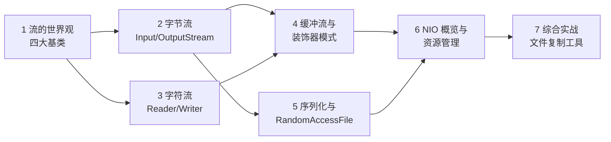
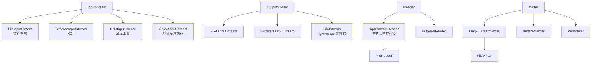

# Java IO：流、缓冲与序列化

> 📚 **来源与核查**：本篇依据 [JavaGuide《Java IO 基础知识总结》](https://javaguide.cn/java/io/io-basis.html)（2026 版，含性能实测数据）、[JavaGuide《JVM 内存区域详解》](https://javaguide.cn/java/jvm/memory-area.html)（NIO 与直接内存）、[Oracle try-with-resources 教程](https://docs.oracle.com/javase/tutorial/essential/exceptions/tryResourceClose.html)、[Jenkov Java IO Tutorial](https://jenkov.com/tutorials/java-io/overview.html) 整理，核查日期 **2026-10-25**。示例环境：Windows 11 + JDK 21；示例代码按 JDK 21 语法撰写，**未在本机实际运行验证**，性能数字引自 JavaGuide 原文实测。

程序的数据总要「进来」和「出去」：读文件、写日志、传网络。Java 把这些统称为 **IO（Input/Output）**，用「流（stream）」建模——数据像水流一样被逐段读写。本篇讲清四大基类的分类矩阵、缓冲为什么能提速百倍、字符与字节的两条世界线，以及对象序列化。完成后你能写出正确关流、不乱码、够快的文件读写代码。

前置：[01_基础入门.md](01_基础入门.md)（异常与 try-with-resources）、[03_集合框架.md](03_集合框架.md)（泛型与集合，实战用到）。

## 🧭 课程地图



一句话路线：先记住分类矩阵（1），字节流与字符流是两条平行主线（2→3），缓冲流像滤镜一样「套」在两条线上（4），序列化是字节流的特例（5），NIO 给个概览即可入门（6），最后写一个带性能对比的复制工具（7）。

## 📖 1. 流的世界观：四大抽象基类

JavaGuide 的总纲：java.io 的 40 多个类**全部派生自 4 个抽象基类**，按「字节还是字符 × 输入还是输出」两维切分：

| | 输入（读入） | 输出（写出） |
|---|---|---|
| **字节流**（任意数据：图片/音视频/压缩包） | `InputStream` | `OutputStream` |
| **字符流**（文本） | `Reader` | `Writer` |



为什么分两条线（JavaGuide 口径）：字节转字符耗时且涉及编码，读文本若用字节流，遇到多字节字符（如中文）容易乱码；所以**媒体文件用字节流、字符内容用字符流**。

❓ **FAQ**

- **Q：`System.out.println` 是流吗？** 是。`System.out` 是 `PrintStream`（字节打印流）的实例，`println` 底层最终调用其 `write` 方法（JavaGuide 口径）；`System.in` 是 InputStream、`System.err` 是 PrintStream。
- **Q：流一定要手动 close 吗？** 文件流等持有系统资源的必须关，推荐 try-with-resources 自动关（见第 6 节）。

📝 **自测**

1. 🟢 读取一张 PNG 图片，应选哪个基类的家族？
   **答案：** InputStream（字节流）——图片是二进制数据，不是「字符」。
2. 🟢 java.io 的 40 多个类派生自几个抽象基类？
   **答案：** 4 个：InputStream、OutputStream、Reader、Writer。
3. 🟡 读 UTF-8 中文文本用字节流逐字节转字符串，风险是什么？
   **答案：** 中文在 UTF-8 下占 3 字节，字节边界切错就乱码——应使用字符流并显式指定 Charset（见第 3 节）。

## 📖 2. 字节流：InputStream 与 OutputStream

`InputStream` 常用方法（JavaGuide 列举）：`read()`（读单字节，返回 0~255，流尽返回 -1）、`read(byte b[])`（批量读入数组）、`read(byte b[], int off, int len)`、`skip(long n)`、`available()`、`close()`；Java 9 起还新增 `readAllBytes()`、`readNBytes()`、`transferTo()`。`OutputStream` 对应 `write(int b)`、`write(byte b[])`、`write(byte[] b, int off, int len)`、`flush()`（把缓冲强制写出）、`close()`。

最小可跑示例——复制文件（逐字节版，慢，仅示范）：

```java
import java.io.FileInputStream;
import java.io.FileOutputStream;
import java.io.IOException;

public class SlowCopy {
    public static void main(String[] args) {
        try (FileInputStream in = new FileInputStream("src.bin");
             FileOutputStream out = new FileOutputStream("dst.bin")) {
            int b;                       // read() 返回 int：0~255 或 -1（结束）
            while ((b = in.read()) != -1) {
                out.write(b);
            }
        } catch (IOException e) {
            System.err.println("复制失败：" + e.getMessage());
        }
    }
}
```

**批量读是第一性能杠杆**。JavaGuide 的实测（复制 524.9 MB PDF）：逐字节 read/write 时普通字节流约 **2 555 062 ms**，缓冲流约 **15 428 ms**——约 1/165；而如果直接用 `read(byte[])` + `write(byte[], off, len)` 且数组大小合适（如 4KB），两者差距就很小了（695 ms vs 989 ms）。结论：**一次读写一个缓冲区大小，而不是一个字节**。

```java
byte[] buf = new byte[4096];             // 4KB 缓冲区
int len;
while ((len = in.read(buf)) != -1) {     // read 返回实际读到的字节数
    out.write(buf, 0, len);              // 只写有效长度，别 write(buf)！
}
```

> ⚠️ **常见坑｜`out.write(buf)` 多写出脏数据**
> 现象：复制出的文件尾部多出一段上次残留内容。原因：最后一次 `read` 往往读不满 buf，数组尾部还是旧数据；`write(buf)` 会把整个数组写出去。做法：永远用 `write(buf, 0, len)`，只写本次实际读到的 len 字节。

`DataInputStream`/`DataOutputStream` 负责「按 Java 基本类型读写」（readInt/writeUTF 等），且 JavaGuide 特别强调：它们**必须包装在其他流上**使用（如套着 FileInputStream），自己不直接连源。

❓ **FAQ**

- **Q：read() 为什么返回 int 而不是 byte？** byte 只有 8 位表达不下「-1 表示结束」这个信号；int 可以用 0~255 表达全部字节值，再用 -1 独占「流结束」。
- **Q：`available()` 能用来取文件大小吗？** 它的语义是「当前不阻塞可读到的字节数」，不保证等于剩余总量，别当 size 用。

📝 **自测**

1. 🟢 `read()` 返回 -1 表示什么？
   **答案：** 流已读到末尾（EOF）。
2. 🟡 为什么循环里要 `write(buf, 0, len)` 而不是 `write(buf)`？
   **答案：** 末次读不满时 buf 尾部是旧数据，整写会多写出脏字节。
3. 🟡 JavaGuide 实测中，「逐字节 + 缓冲流」与「4KB 数组 + 普通流」哪个更接近最优？
   **答案：** 后者（695 ms vs 989 ms 一档）——批量字节数组本身就是关键优化，缓冲流的优势在逐字节调用场景。

## 📖 3. 字符流与编码：Reader、Writer 与 Charset

字符流的两个基类面向**文本**：`Reader` 的 `read()` 读字符、`Writer` 支持 `write(char[])`/`write(String)` 及 `append()`。字节与字符两个世界靠两个「桥梁」互通（JavaGuide 口径）：

- **`InputStreamReader`：字节流 → 字符流的桥梁**（把字节按编码解码成字符），其子类 `FileReader` 用于读字符文件；
- **`OutputStreamWriter`：字符流 → 字节流的桥梁**（把字符按编码编码成字节），子类 `FileWriter`。

转换必须指定**字符集（Charset）**；JavaGuide 提醒：不指定时使用 **JVM 默认字符集**——这正是「我机器上好好的、换台机器就乱码」的经典根源。编码常识（本系列 [01_基础入门.md](01_基础入门.md) 已铺垫）：Unicode 是字符集，UTF-8/UTF-16/UTF-32 是编码方式；UTF-8 下英文 1 字节、中文通常 3 字节。

```java
import java.io.BufferedReader;
import java.io.IOException;
import java.nio.charset.StandardCharsets;
import java.nio.file.Files;
import java.nio.file.Path;

// 现代写法（java.nio.file.Files + Path.of，JDK 11+）：
try (BufferedReader br = Files.newBufferedReader(Path.of("data.txt"), StandardCharsets.UTF_8)) {
    String line;
    while ((line = br.readLine()) != null) {   // readLine：读一行，流尽返回 null
        System.out.println(line);
    }
}
```

> ⚠️ **常见坑｜不指定 Charset，代码换个环境就乱码**
> 现象：Windows 写的日志在 Linux 服务器读出乱码。原因：两个系统的 JVM 默认字符集可能不同，读写两端不一致。做法：任何跨环境读写的文本都**显式**传 `StandardCharsets.UTF_8`。

❓ **FAQ**

- **Q：FileReader 和 InputStreamReader 什么关系？** FileReader 是 InputStreamReader 的子类，专门读文件；需要自定义编码或包装非文件流（如网络流）时用 InputStreamReader 更灵活。
- **Q：Writer 的 `flush()` 什么时候调用？** 缓冲型输出流在 close 前通常自动 flush；但「数据必须立刻对别人可见」（如日志、对端交互）时要手动 flush。

📝 **自测**

1. 🟢 「字节流转字符流」的桥梁类是？
   **答案：** `InputStreamReader`。
2. 🟡 不指定 Charset 时，转换流用什么编码？
   **答案：** JVM 默认字符集（随平台变化，跨环境不可靠）。
3. 🟢 `readLine()` 的结束标志是？
   **答案：** 返回 null（区别于字节流 read 的 -1）。

## 📖 4. 缓冲流与装饰器模式

`BufferedInputStream`/`BufferedOutputStream` 的原理（JavaGuide）：内部维护一个**默认 8192 字节**的字节数组缓冲区（可自定义大小），先把磁盘数据成块搬进缓冲区，程序再从内存缓冲区里取——把「每字节一次系统调用」降为「每 8KB 一次」。`BufferedReader`/`BufferedWriter` 同理，只是缓冲的是字符。

注意其设计手法：BufferedInputStream **没有替代** FileInputStream，而是**包在它外面**增强它——这正是**装饰器模式（Decorator）**，JavaGuide 明确指出缓冲流「采用装饰器模式增强功能」。装饰器在不改原类、不继承的前提下叠加功能，java.io 是它最著名的舞台（模式的完整讲解见 [07_设计模式.md](07_设计模式.md)）。

```java
import java.io.*;

// 一层套一层：FileInputStream 提供数据源，BufferedInputStream 提供缓冲
try (BufferedInputStream in = new BufferedInputStream(new FileInputStream("a.bin"));
     BufferedOutputStream out = new BufferedOutputStream(new FileOutputStream("b.bin"))) {
    int b;
    while ((b = in.read()) != -1) {   // 逐字节 API，但实际按 8KB 成块搬运
        out.write(b);
    }
}   // try 块结束自动 close（后开先关）
```

> 💡 **技巧｜包装流关闭一个就够**
> try-with-resources 里只需登记最外层包装流（如 BufferedInputStream）：关闭包装流时它会**级联关闭**被包装的底层流，无需层层 close。

❓ **FAQ**

- **Q：既然缓冲流这么快，普通流还有存在意义吗？** 有——缓冲流自己不能凭空读数据，它必须装饰一个真实的数据源流；且一次性大块读（read(byte[])）场景下普通流已够快。
- **Q：缓冲流为什么「后开先关」？** close 顺序与创建相反，保证上层缓冲先 flush 落盘，再关底层流；try-with-resources 自动按此顺序执行。

📝 **自测**

1. 🟢 BufferedInputStream 的默认缓冲区大小？
   **答案：** 8192 字节（8KB）。
2. 🟡 缓冲流提速的本质是什么？
   **答案：** 减少底层系统调用次数——内存缓冲区一次搬 8KB，程序逐字节操作发生在内存里。
3. 🟡 BufferedInputStream 与 FileInputStream 是继承关系还是装饰关系？
   **答案：** 兄弟（同继承 InputStream）+ 装饰关系——前者持有后者并增强，不是其子类。

## 📖 5. 序列化与 RandomAccessFile

**序列化（serialization）**：把内存对象转成字节流写出；**反序列化**是把字节流还原成对象。JavaGuide 的规则：

- 要序列化的类必须实现 **`Serializable`** 接口（标记接口，无方法）；
- 不想被序列化的字段用 **`transient`** 修饰（如密码）；
- 用 `ObjectOutputStream.writeObject()` 写、`ObjectInputStream.readObject()` 读。

```java
import java.io.*;

class User implements Serializable {
    String name;
    transient String password;        // transient：序列化时跳过
    User(String name, String password) { this.name = name; this.password = password; }
    @Override public String toString() { return name + "/" + password; }
}

public class SerDemo {
    public static void main(String[] args) throws Exception {
        try (ObjectOutputStream oos = new ObjectOutputStream(new FileOutputStream("user.dat"))) {
            oos.writeObject(new User("小张", "secret"));      // 序列化
        }
        try (ObjectInputStream ois = new ObjectInputStream(new FileInputStream("user.dat"))) {
            User u = (User) ois.readObject();                // 反序列化
            System.out.println(u);                           // 小张/null：password 被跳过
        }
    }
}
```

待验证: `serialVersionUID` 的版本校验机制与「不声明时编译器自动生成」的细节（本篇来源页未展开），生产项目建议显式声明该字段，具体规则请查 Serializable 的官方 Javadoc。

**RandomAccessFile（随机访问流）**：不沿流顺序读，而能用 `seek()` 跳到文件任意位置读写（`getFilePointer()` 返回当前位置）。模式四种：`r` 只读、`rw` 读写、`rws`/`rwd` 读写并强制同步刷盘。JavaGuide 列举其典型应用：**大文件断点续传与分片合并**（配合 FileDescriptor 与 FileChannel）。

❓ **FAQ**

- **Q：静态字段会被序列化吗？** 不会——序列化保存的是对象的瞬时状态，静态属于类不随对象走；transient 则是显式排除实例字段。
- **Q：序列化深拷贝靠谱吗？** 把对象序列化再反序列化可以得到一份深拷贝，但要求整条对象图全部可序列化，且有性能代价。

📝 **自测**

1. 🟢 哪个关键字修饰的字段不参与序列化？
   **答案：** `transient`。
2. 🟢 Serializable 接口里有几个方法？
   **答案：** 0 个（标记接口，只向 JVM 声明「本类可序列化」）。
3. 🟡 断点续传这类「跳到文件中间继续写」的需求选什么类？
   **答案：** RandomAccessFile（seek 定位 + rw 模式）。

## 📖 6. NIO 概览与资源管理

**NIO（New IO / Non-blocking IO）**：JDK 1.4 引入的新 IO 体系，JavaGuide（JVM 内存区域篇）概括其核心是「基于 **Channel（通道）与 Buffer（缓冲区）** 的 I/O 方式」。与传统流最大的不同：流是单向的、顺序的；Channel 是双向的，配合 Buffer 可以「读一点、写一点、来回倒」，并且支持 `DirectByteBuffer` **直接内存（堆外内存）**——不受 Java 堆管理，能减少「内核缓冲区 ↔ 堆内缓冲区」的一次中间复制，代价是分配回收成本高（细节见 [06_jvm.md](06_jvm.md) 直接内存一节）。

入门阶段不必系统学 NIO，记住两件事：① 读文件用 `Files`（java.nio.file 包）+ `Path` 比老 File API 顺手得多；② 网络高并发场景（如百万连接服务器）NIO 的非阻塞多路复用才是主场，属于进阶主题。

**资源管理统一姿势**——try-with-resources（Oracle 教程口径：语句结束时自动关闭每个声明的资源），三条经验：

1. 所有实现 `AutoCloseable` 的资源都可以放 `try(...)`，多个用分号隔开；
2. 只登记最外层包装流（级联关闭）；
3. 声明顺序即关闭的反序（后开先关）。

❓ **FAQ**

- **Q：IO 和 NIO 该学哪个？** 都要：文件读写日常用 java.nio.file 的 Files/Path（封装更好），流式处理与网络基础仍是经典 IO 的地盘；两者互补而非替代。
- **Q：直接内存越大越好吗？** 不是。它绕过堆管理，泄漏了不易发现，且受本机总内存限制；常规文件读写用堆内缓冲即可。

📝 **自测**

1. 🟢 NIO 的两大核心抽象是？
   **答案：** Channel（通道）与 Buffer（缓冲区）。
2. 🟡 直接内存（DirectByteBuffer）换来了什么、付出了什么？
   **答案：** 减少「内核 ↔ 堆」一次中间复制；但分配回收成本高、不受堆 GC 直接管理。
3. 🟢 try-with-resources 中多个资源的关闭顺序？
   **答案：** 与声明相反（后声明的先关）。

## 🚀 7. 综合实战：文件复制工具（含性能对比）

写一个工具，用两种方式复制同一文件并计时，验证第 2、4 节的结论：缓冲 + 批量才是速度的关键。

```java
import java.io.*;
import java.nio.file.Files;
import java.nio.file.Path;

public class CopyBench {
    public static void main(String[] args) throws IOException {
        // 先造一个 10MB 的测试文件
        Path src = Path.of("bench-src.bin");
        byte[] seed = new byte[1024 * 1024];
        try (OutputStream os = Files.newOutputStream(src)) {
            for (int i = 0; i < 10; i++) os.write(seed);
        }

        long t1 = System.nanoTime();
        copyBuffered(src.toString(), "bench-dst1.bin");   // 方式一：缓冲流逐字节
        long t2 = System.nanoTime();
        copyArray(src.toString(), "bench-dst2.bin");      // 方式二：4KB 数组直读写
        long t3 = System.nanoTime();

        System.out.printf("缓冲流逐字节：%d ms%n", (t2 - t1) / 1_000_000);
        System.out.printf("4KB 数组批量：%d ms%n", (t3 - t2) / 1_000_000);
        System.out.println("大小一致：" + (Files.size(Path.of("bench-dst1.bin"))
                == Files.size(Path.of("bench-dst2.bin"))));
    }

    static void copyBuffered(String src, String dst) throws IOException {
        try (InputStream in = new BufferedInputStream(new FileInputStream(src));
             OutputStream out = new BufferedOutputStream(new FileOutputStream(dst))) {
            int b;
            while ((b = in.read()) != -1) out.write(b);
        }
    }

    static void copyArray(String src, String dst) throws IOException {
        try (InputStream in = new FileInputStream(src);
             OutputStream out = new FileOutputStream(dst)) {
            byte[] buf = new byte[4096];
            int len;
            while ((len = in.read(buf)) != -1) out.write(buf, 0, len);
        }
    }
}
```

在本机跑几次对比两个数字的关系（缓存预热会干扰首跑，建议各跑三次取中位）。练习：① 加第三种 `in.transferTo(out)`（Java 9+，见第 2 节方法清单）对比；② 把 byte[] 改成 64KB 再看变化；③ 换成读文本统计行数，注意显式 UTF-8。

## 📚 8. 来源与进一步学习

- [JavaGuide：Java IO 基础知识总结](https://javaguide.cn/java/io/io-basis.html)（四大基类与实现类、缓冲流实测数据、序列化、RandomAccessFile、编码）——核查 2026-10-25
- [JavaGuide：JVM 内存区域详解](https://javaguide.cn/java/jvm/memory-area.html)（NIO 与直接内存）——核查 2026-10-25
- [Oracle：try-with-resources](https://docs.oracle.com/javase/tutorial/essential/exceptions/tryResourceClose.html)——核查 2026-10-25
- [Jenkov：Java IO Overview](https://jenkov.com/tutorials/java-io/overview.html)（英文经典教程，正文未能抓取成功，条目经搜索核实存在）——核查 2026-10-25
- 下一篇：[05_并发编程.md](05_并发编程.md)；装饰器模式的展开见 [07_设计模式.md](07_设计模式.md)
