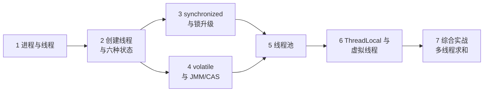
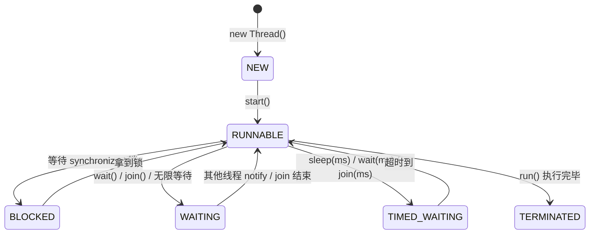

# Java 并发编程：线程、锁、线程池

> 📚 **来源与核查**：本篇依据 [JavaGuide《Java 并发常见面试题》上/中/下](https://javaguide.cn/java/concurrent/java-concurrent-questions-01.html)（2026-06 版）、[JavaGuide《虚拟线程常见问题总结》](https://javaguide.cn/java/concurrent/virtual-thread.html)、[JEP 444: Virtual Threads](https://openjdk.org/jeps/444)、[Oracle Virtual Threads 文档](https://docs.oracle.com/en/java/javase/21/core/virtual-threads.html) 整理，核查日期 **2026-10-25**。示例环境：Windows 11 + JDK 21。

现代机器都是多核，浏览器要同时下载图片和渲染页面、服务器要同时处理成百上千个请求——并发是绕不开的主题。本篇讲五块地基：线程模型、synchronized 与锁、volatile 与内存可见性、线程池、ThreadLocal，最后看一眼 JDK 21 的虚拟线程。完成后你能安全地写出多线程代码，并回答并发方向的高频面试题。

前置：[01_基础入门.md](01_基础入门.md)、[03_集合框架.md](03_集合框架.md)（ConcurrentHashMap 在第 3 节已讲）。

## 🧭 课程地图



一句话路线：先建立「线程是什么、怎么开」（1→2），两大同步工具 synchronized 与 volatile 并列（3→4），工程上几乎不手开线程而用线程池（5），ThreadLocal 与虚拟线程是两个高频专题（6），实战里把线程池跑起来（7）。

## 📖 1. 进程与线程

**进程（process）** 是程序的一次执行过程、系统运行程序的基本单位；**线程（thread）** 是比进程更小的执行单位，一个进程可产生多个线程。启动 `main` 函数就是启动了一个 JVM 进程。

内存视角（JavaGuide 口径，与 [06_jvm.md](06_jvm.md) 对应）：线程之间**共享**进程的**堆和方法区**（JDK 8 后为元空间）；**私有**的则是**程序计数器、虚拟机栈、本地方法栈**——私有是为了线程切换后能恢复到正确执行位置、保护各自局部变量不被别的线程访问。共享带来通信的便利，也带来本篇主角：**竞态与同步**。

两个常识：① Java 程序**天生多线程**——你一行并发代码都不写，JVM 里也有 main、Finalizer、Reference Handler 等线程在跑；② 线程切换需要保存/恢复上下文，**频繁上下文切换本身是开销**（这是后面线程池「线程不是越多越好」的伏笔）。

❓ **FAQ**

- **Q：并发（concurrency）和并行（parallelism）的区别？** 并发是「同一时段内多个任务交替推进」（单核也可以），并行是「同一时刻多个任务同时执行」（需要多核）。吃饭时来回夹两口菜再回消息是并发；边吃饭边打电话是并行。
- **Q：为什么程序计数器必须线程私有？** 线程切换后要恢复执行位置，各线程的执行点不同，共享一个计数器就互相踩踏了。

📝 **自测**

1. 🟢 多线程共享的区域是？
   **答案：** 堆和方法区（元空间）。解析：选「栈」的新手混淆了共享/私有边界——三个栈区（程序计数器、虚拟机栈、本地方法栈）都是私有的。
2. 🟢 完全不写多线程代码，JVM 里就只有 main 一个线程吗？
   **答案：** 不是，还有 Finalizer、Reference Handler 等（Java 天生多线程）。

## 📖 2. 线程的创建与生命周期

创建线程的常见写法：

```java
// 方式一：继承 Thread
class MyThread extends Thread {
    @Override public void run() { System.out.println("继承 Thread"); }
}

// 方式二：实现 Runnable（推荐：不占继承名额、任务与线程解耦）
Runnable task = () -> System.out.println("实现 Runnable");

new MyThread().start();
new Thread(task).start();
```

JavaGuide 的清醒提示：**严格来说 Java 只有 `new Thread().start()` 一种真正创建线程的方式**——实现 Runnable/Callable、线程池、CompletableFuture 都只是组织任务的姿势，最终都依赖它。另一个高频坑：**直接调用 `run()` 只是普通方法调用**（在当前线程同步执行），必须 `start()` 才会新建线程。

**线程的六种状态**（`Thread.State` 枚举，JVM 层面口径）：



注意 JVM 把操作系统的 READY 和 RUNNING 统称 **RUNNABLE**（「等待 CPU」和「正在运行」在 Java 层不区分）。BLOCKED 特指等 `synchronized` 监视器锁；调用 `wait()` 进 WAITING、`sleep(ms)` 进 TIMED_WAITING。

> ⚠️ **常见坑｜调 run() 不调 start()**
> 现象：日志看起来「多线程」执行了，但顺序输出、毫无并发。原因：`run()` 是普通方法调用，跑在当前线程里；`start()` 才向 JVM 申请新线程。做法：永远 `start()`；需要拿到任务结果用 Callable + Future（见实战）。

❓ **FAQ**

- **Q：Runnable 和 Callable 的区别？** Runnable 的 `run()` 无返回值、不能抛受检异常；Callable 的 `call()` 有返回值、可抛异常，配合 Future/线程池拿结果。
- **Q：`sleep()` 和 `wait()` 的区别？** wait/notify 依赖对象的 monitor，**只能在同步块内调用**（JavaGuide 口径），等待时让出锁，由其他线程 notify 唤醒；sleep 是 Thread 的静态方法，不涉及任何锁，到点自己醒。

📝 **自测**

1. 🟢 让新线程真正启动的方法是？
   **答案：** `start()`（`run()` 只是同步调用）。解析：这是并发第一坑，代码能跑、结果「不对」——没有报错更迷惑。
2. 🟢 线程调用 `Thread.sleep(1000)` 进入哪个状态？
   **答案：** TIMED_WAITING。
3. 🟡 等 `synchronized` 锁的线程处于哪个状态？
   **答案：** BLOCKED（WAITING 是 wait/join 那类）。
4. 🔴 「实现 Runnable 也算创建线程的一种方式」这个说法对吗？
   **答案：** 严格说不对——Runnable 只是任务载体，真正创建线程的只有 `new Thread().start()`（JavaGuide 口径）。

## 📖 3. synchronized 与锁升级

**synchronized 三种用法**（JavaGuide 口径）：

```java
class Counter {
    private int count = 0;
    private final Object lock = new Object();

    public synchronized void addA() { count++; }        // 1. 实例方法：锁当前对象实例
    public static synchronized void addB() { /*...*/ }  // 2. 静态方法：锁当前类的 Class 对象
    public void addC() {
        synchronized (lock) { count++; }                // 3. 代码块：锁指定对象
    }
}
```

要点：静态与非静态 synchronized 方法**不互斥**（锁的是不同对象：Class vs 实例）；**不建议 `synchronized("常量字符串")`**——字符串常量池有缓存，别处锁同一个字面量就意外互斥了；**构造方法不能用 synchronized 修饰**（内部可用同步块）。

**底层原理**（JavaGuide，从字节码与 HotSpot 实现讲）：同步代码块编译为 `monitorenter` / `monitorexit` 指令（编译器生成两个 monitorexit，保证异常路径也能释放锁）；修饰方法时没有这两条指令，而是方法标志位 **ACC_SYNCHRONIZED**。每个对象内置一个基于 C++ ObjectMonitor 的 monitor，获取锁即计数器置 1、可重入再加 1、monitorexit 归 0 后其他线程才能竞争——`wait/notify` 正是依赖这个 monitor，所以只能在同步块内调用。

**锁升级**（HotSpot 优化路径）：**无锁 → 偏向锁 → 轻量级锁 → 重量级锁**，只升不降。注意版本口径（JavaGuide）：**偏向锁 JDK 15 起默认关闭**（`-XX:+UseBiasedLocking` 可开），**JDK 18 彻底废弃**——原因是收益不明显（撤销偏向需在 safe point 暂停所有线程，开销大）且维护成本高。面试答「升级四态 + 偏向锁已废弃」即可。

> ⚠️ **常见坑｜锁了 String 字面量导致无谓互斥**
> 现象：两段「不相干」的代码互相阻塞。原因：`synchronized("lock")` 锁的是常量池里同一个缓存对象。做法：锁专用对象 `private final Object lock = new Object()`，或锁 `this`/`类.class`。

❓ **FAQ**

- **Q：synchronized 是可重入锁吗？** 是。同线程可重复获取自己已持有的锁（计数器累加），同步方法里调另一个同锁同步方法不会死锁。
- **Q：什么叫「锁升级不可降级」？** 一旦竞争激烈升到重量级锁（依赖操作系统 mutex），即使之后竞争消失也保持重量级，直到对象锁被完全释放。

📝 **自测**

1. 🟢 synchronized 修饰实例方法，锁的对象是？
   **答案：** 当前实例（this）。静态方法则锁 Class 对象。
2. 🟡 同一个类里，静态 synchronized 方法 A 与实例 synchronized 方法 B 会互斥吗？
   **答案：** 不会——锁对象分别是 Class 与实例，两把不同的锁。解析：认为「都是 synchronized 就互斥」的新手把「关键字」当成了「锁」。
3. 🟡 同步代码块的字节码指令是哪两条？方法级同步靠什么？
   **答案：** monitorenter / monitorexit；方法级靠 ACC_SYNCHRONIZED 标志位。
4. 🔴 偏向锁的现状（版本口径）？
   **答案：** JDK 15 默认关闭、JDK 18 废弃。

## 📖 4. volatile、JMM 与 CAS

**JMM（Java Memory Model，Java 内存模型）**：每个线程有自己的工作内存（可粗糙理解为 CPU 缓存的抽象），共享变量在主内存——线程对变量的操作发生在工作内存，何时刷回主内存不确定，这就是可见性问题的根源。注意 JavaGuide 的纠偏：volatile 的语义是 **JMM 规定**，**不能**通俗解释为「禁用 CPU 缓存」。

**volatile 的两大保证与一大不保证**（高频考点）：保证**可见性**（写立即对其他线程可见）、**禁止指令重排序**（通过插入内存屏障：写前 StoreStore、写后 StoreLoad、读后 LoadLoad + LoadStore，共四种屏障）；但**不保证原子性**——经典反例：5 个线程各对 `count++` 500 次，结果小于 2500，因为 `++` 是「读-加-写」三步复合操作。

```java
class VolatileDemo {
    static volatile boolean stop = false;      // 可见性：主线程改 stop，工作线程立刻看到
    // static volatile int count = 0;          // 错误用法：count++ 仍会丢更新！

    public static void main(String[] args) throws InterruptedException {
        new Thread(() -> {
            while (!stop) { /* 干活 */ }
            System.out.println("工作线程退出");
        }).start();
        Thread.sleep(100);
        stop = true;                            // 不加 volatile，工作线程可能永远看不到
    }
}
```

**happens-before** 里与 volatile 相关的规则：对 volatile 变量的**写** happens-before 于后续对该变量的**读**；结合传递性，volatile 写之前的普通写、对 volatile 读之后的操作也可见。**DCL 双重检验锁单例必须给实例加 volatile**：`new Singleton()` 大致分「分配内存 → 初始化 → 赋引用」三步，2/3 可能重排，别的线程可能拿到未初始化完的引用（单例完整实现见 [07_设计模式.md](07_设计模式.md)）。

**ReentrantLock vs synchronized**（JavaGuide）：两者都是可重入锁；synchronized 是 JVM 关键字（monitor 实现），ReentrantLock 是 JDK API 层类、底层基于 **AQS**；ReentrantLock 多出三样能力——**等待可中断**（`lockInterruptibly()`）、**可配公平锁**（默认非公平，公平=优先等最久的线程）、**多条件唤醒**（多个 Condition 选择性通知），外加 `tryLock(timeout)` 超时尝试。

**CAS（Compare-And-Swap，比较并交换）**：三个操作数——变量 V、预期值 E、新值 N；V == E 时才把 V 更新为 N，否则失败重试，由 CPU 原子指令保证。Java 经 `Unsafe` 的 compareAndSwap 系列方法使用，`AtomicInteger` 等原子类的自增就是 do-while 自旋 CAS。三大问题（JavaGuide）：① **ABA**（值被改走又改回，CAS 察觉不到，用版本号方案如 `AtomicStampedReference` 解决）；② 自旋失败久了空耗 CPU；③ 只能保证**单个**变量（多变量用 AtomicReference 打包或加锁）。

> ⚠️ **常见坑｜用 volatile 修饰计数器**
> 现象：`volatile int count` 多线程 `count++` 仍然丢更新。原因：volatile 不保证原子性，`++` 是复合操作。做法：用 `AtomicInteger.incrementAndGet()`，或加锁；高并发纯计数可用 LongAdder（空间换时间，JavaGuide 提及）。

❓ **FAQ**

- **Q：什么时候用 volatile？** 「一写多读」的开关/标志位、DCL 单例的实例字段。有复合操作（++、check-then-act）就不能只靠它。
- **Q：乐观锁和悲观锁怎么选？** JavaGuide 口径——乐观（CAS 类）适合**多读少写**，悲观（加锁）适合**写多**。

📝 **自测**

1. 🟢 volatile 不保证什么？
   **答案：** 原子性（保证可见性与禁止指令重排）。解析：把它当「轻量级 synchronized」用是新手最常见的错误心智模型。
2. 🟡 DCL 单例为什么必须 volatile？
   **答案：** 防止「分配-初始化-赋引用」重排后，其他线程经第一个 null 检查拿到未初始化完的对象。
3. 🟡 CAS 的 ABA 问题是什么？怎么解决？
   **答案：** 值 A→B→A，CAS 只看到「还是 A」误以为没变过；带版本号/时间戳（AtomicStampedReference）。
4. 🔴 ReentrantLock 相比 synchronized 多出的三个能力？
   **答案：** 等待可中断、可配公平锁、多 Condition 选择性通知（另有 tryLock 超时）。

## 📖 5. 线程池

**为什么用线程池**：线程创建销毁有成本、无上限开线程会耗尽资源、频繁上下文切换拖慢系统——线程池复用线程、削峰排队。

**ThreadPoolExecutor 七个构造参数**（JavaGuide，面试必背）：

```java
ExecutorService pool = new ThreadPoolExecutor(
        4,                                  // corePoolSize 核心线程数：常驻，空闲也保留
        8,                                  // maximumPoolSize 最大线程数
        60, TimeUnit.SECONDS,               // keepAliveTime + unit：超出核心数的空闲线程存活时间
        new ArrayBlockingQueue<>(100),      // workQueue 任务队列（这里用有界队列）
        Executors.defaultThreadFactory(),   // threadFactory 线程工厂
        new ThreadPoolExecutor.AbortPolicy() // handler 拒绝策略
);
```

**任务处理流程**（三步铁律）：① 运行线程数 < corePoolSize → 直接建线程执行；② 达到核心数 → 任务入队；③ **队列满**且线程数 < maximumPoolSize → 再建线程；已达最大数 → 执行**拒绝策略**。

**四种拒绝策略**：`AbortPolicy`（默认，抛异常）、`CallerRunsPolicy`（提交任务的线程自己跑，天然反压）、`DiscardPolicy`（静默丢弃）、`DiscardOldestPolicy`（丢最老任务再重试）。

**不要用 Executors 快捷方法**（阿里巴巴手册强制的口径，经 JavaGuide 转述）：`FixedThreadPool`/`SingleThreadExecutor` 用容量 Integer.MAX_VALUE 的无界 LinkedBlockingQueue（堆积致 OOM）；`CachedThreadPool` 的 maximumPoolSize 是 Integer.MAX_VALUE（线程爆炸致 OOM）；Scheduled 系列用无界 DelayedWorkQueue 同理。**一律手动 new ThreadPoolExecutor**，并指定有界队列。

**大小怎么设**（JavaGuide）：CPU 密集型 **N+1**（N 为核数，多 1 个防缺页暂停时 CPU 空转）；I/O 密集型 **2N**；更精确的公式 **N × (1 + WT/ST)**（等待时间/计算时间，可用 VisualVM 观察）。此外：`execute()` 提交的任务若抛未捕获异常，线程销毁、池补新线程（有损耗）；`submit()` 把异常封装进 Future，线程继续复用——**生产代码优先 submit 或在任务内兜住异常**。

> ⚠️ **常见坑｜OOM 事故三连：无界队列 + 无界线程 + 不处理拒绝**
> 现象：流量一上来服务 OOM。原因：Executors 便捷方法要么队列无界、要么线程无界，拒绝策略也没人接。做法：手动构造池（有界队列 + 明确拒绝策略），压测确定参数。

❓ **FAQ**

- **Q：核心线程能被回收吗？** 可通过 `allowCoreThreadTimeOut(true)` 让核心线程也超时退出；反之可 `prestartCoreThread()` 提前预热。
- **Q：任务队列用哪个？** 有界优先 `ArrayBlockingQueue`（防止堆积）；`SynchronousQueue` 不存任务、直接交接（CachedThreadPool 用它）；任务间有延迟用 `DelayedWorkQueue`。

📝 **自测**

1. 🟢 核心线程满后，新任务第一反应是开新线程还是排队？
   **答案：** 排队入 workQueue（队列满才开新线程直到 maximumPoolSize）。解析：很多人记成「先开满最大线程数再排队」——恰好反了，这是本题唯一也是最经典的干扰项。
2. 🟡 默认拒绝策略是什么？行为？
   **答案：** AbortPolicy，抛 RejectedExecutionException。
3. 🟡 为什么禁止 Executors 创建线程池？
   **答案：** 其快捷方法的队列或最大线程数近乎无界，易 OOM（阿里手册强制条款）。
4. 🔴 8 核机器跑「主要等数据库返回」的任务，线程数大致设多少？
   **答案：** 经验值 2N = 16（I/O 密集型），更准用 N×(1+WT/ST) 实测。

## 📖 6. ThreadLocal 与虚拟线程

**ThreadLocal（线程本地变量）**：给每个线程一份独立副本，互不干扰。原理（JavaGuide）：`Thread` 类自带 `threadLocals`（和 `inheritableThreadLocals`）两个 ThreadLocalMap 字段，首次 set/get 时创建——数据存在**线程自己**的 map 里，key 是 ThreadLocal 实例，value 是存的值。

**内存泄漏**是必考的深水区：Entry 的 **key 是弱引用**（ThreadLocal 失去外部强引用后，下次 GC 把 key 回收为 null），**value 是强引用**——key 没了 value 还被 Entry 拽着，回收不掉。JavaGuide 强调泄漏需同时满足两个条件：**ThreadLocal 实例不再被强引用 + 线程长期存活**（典型：线程池线程复用）。key 用弱引用是兜底设计（若用强引用，忘记 remove 时 key/value 一起泄漏；弱引用至少给被动清理留了机会），但 **`remove()` 必须手动调**，推荐 try-finally：

```java
private static final ThreadLocal<SimpleDateFormat> FMT =
        ThreadLocal.withInitial(() -> new SimpleDateFormat("yyyy-MM-dd"));

try {
    System.out.println(FMT.get().format(System.currentTimeMillis()));
} finally {
    FMT.remove();     // 用完必删，尤其在线程池环境
}
```

跨线程传递：`InheritableThreadLocal` 在**创建子线程时**复制父线程的值（一次性，线程池复用线程时失效出脏数据）；阿里的 `TransmittableThreadLocal`（TTL）用装饰器包装任务/线程池，以 Capture-Replay-Restore 机制支持线程池场景。

**虚拟线程（Virtual Threads）**：JDK 19/20 预览、**JDK 21 经 [JEP 444](https://openjdk.org/jeps/444) 正式发布**（Oracle 官方文档同口径）。它由 JVM 调度、运行在少量载体平台线程上，阻塞一个虚拟线程的代价极小——「一个请求一个线程」的简单写法也能撑起百万级并发。用法与适用边界详见 [JavaGuide 虚拟线程篇](https://javaguide.cn/java/concurrent/virtual-thread.html)。

> ⚠️ **常见坑｜线程池里 ThreadLocal 不 remove**
> 现象：任务间读到上一个任务的「用户信息」，偶现串号。原因：线程池线程长期存活，上一个任务 set 的 value 还挂在 ThreadLocalMap 里。做法：finally 中 remove；跨任务传参别依赖 ThreadLocal 的「自动隔离」。

❓ **FAQ**

- **Q：ThreadLocal 能解决共享变量的竞争吗？** 不能也不需要——它让每个线程用各自的副本，从根上不共享；要保护「同一个」变量还是得用第 3、4 节的锁/原子类。
- **Q：key 为什么设计成弱引用？** 兜底：即便忘 remove，ThreadLocal 实例被回收后 key 变 null，map 的 get/set/remove 有机会被动清理这些条目——但不可靠，手动 remove 仍是规范。

📝 **自测**

1. 🟢 ThreadLocal 的数据实际存在哪里？
   **答案：** 每个线程自己的 ThreadLocalMap（key=ThreadLocal 实例，value=值）。
2. 🟡 内存泄漏的两要素？
   **答案：** ThreadLocal 实例失去外部强引用（弱引用 key 被回收）+ 线程长期存活（线程池），value 被强引用挂着。
3. 🟢 虚拟线程从哪个版本正式可用？
   **答案：** JDK 21（JEP 444；19/20 为预览）。

## 🚀 7. 综合实战：多线程数组求和

用线程池把 1 亿个随机数分 8 段并行求和，串起第 2、5 节：Callable 返回结果、Future 收集、显式构造线程池、优雅关闭。

```java
import java.util.ArrayList;
import java.util.List;
import java.util.Random;
import java.util.concurrent.*;

public class ParallelSum {
    static final int N = 100_000_000;
    static final int THREADS = 8;

    public static void main(String[] args) throws Exception {
        int[] data = new int[N];
        Random r = new Random(42);
        for (int i = 0; i < N; i++) data[i] = r.nextInt(100);

        // 单线程基准
        long serial = 0;
        long t0 = System.nanoTime();
        for (int v : data) serial += v;
        long t1 = System.nanoTime();
        System.out.printf("单线程：%d，耗时 %d ms%n", serial, (t1 - t0) / 1_000_000);

        // 手动构造线程池：CPU 密集，核心数 = 核数附近（8 段）
        ExecutorService pool = new ThreadPoolExecutor(
                THREADS, THREADS, 60, TimeUnit.SECONDS,
                new ArrayBlockingQueue<>(THREADS),
                Executors.defaultThreadFactory(),
                new ThreadPoolExecutor.CallerRunsPolicy());

        try {
            List<Future<Long>> futures = new ArrayList<>();
            int chunk = N / THREADS;
            for (int i = 0; i < THREADS; i++) {
                final int from = i * chunk;
                final int to = (i == THREADS - 1) ? N : from + chunk;
                futures.add(pool.submit(() -> {          // submit：异常进 Future，线程可复用
                    long sum = 0;
                    for (int k = from; k < to; k++) sum += data[k];
                    return sum;
                }));
            }
            long parallel = 0;
            for (Future<Long> f : futures) parallel += f.get();   // 阻塞收集
            long t2 = System.nanoTime();
            System.out.printf("多线程：%d，耗时 %d ms%n", parallel, (t2 - t1) / 1_000_000);
        } finally {
            pool.shutdown();          // 不再接新任务，已提交的跑完
            pool.awaitTermination(1, TimeUnit.MINUTES);
        }
    }
}
```

观察点：两行总和相等；加速通常明显但不到 8 倍（内存带宽与调度开销）。练习：① 把 THREADS 改成 64 看是否还变快（上下文切换反噬）；② 把 `pool.submit` 换成 `pool.execute`，想想结果怎么拿；③ 用 `LongAdder` 对比（第 4 节）。

## 📚 8. 来源与进一步学习

- [JavaGuide：Java 并发常见面试题（上）](https://javaguide.cn/java/concurrent/java-concurrent-questions-01.html)（进程线程、六状态、死锁四条件）／[（中）](https://javaguide.cn/java/concurrent/java-concurrent-questions-02.html)（synchronized 原理与锁升级、volatile、JMM、ReentrantLock、CAS）／[（下）](https://javaguide.cn/java/concurrent/java-concurrent-questions-03.html)（线程池、ThreadLocal）——核查 2026-10-25
- [JavaGuide：虚拟线程常见问题总结](https://javaguide.cn/java/concurrent/virtual-thread.html)／[JEP 444](https://openjdk.org/jeps/444)／[Oracle Virtual Threads](https://docs.oracle.com/en/java/javase/21/core/virtual-threads.html)——核查 2026-10-25
- 死锁四条件与检测工具（jstack / jcmd / JConsole / VisualVM）出自上篇，展开见 [06_jvm.md](06_jvm.md) 排错一节
- 下一篇：[06_jvm.md](06_jvm.md)；线程安全的 Map 见 [03_集合框架.md](03_集合框架.md) 第 3 节
