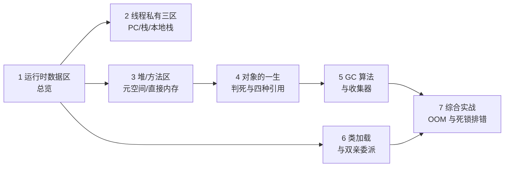
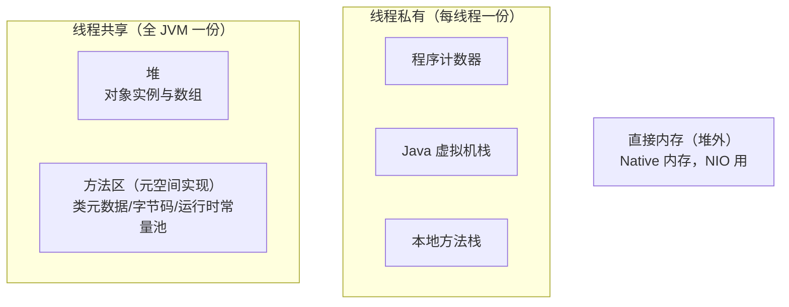
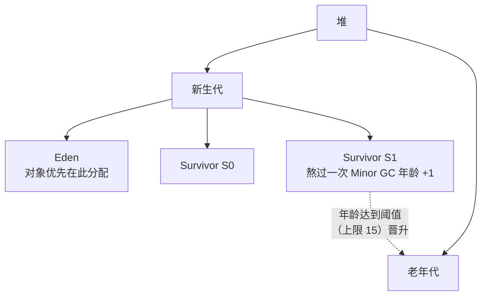

# JVM 入门：内存区域、GC 与类加载

> 📚 **来源与核查**：本篇依据 [JavaGuide《JVM 内存区域详解》](https://javaguide.cn/java/jvm/memory-area.html)、[《JVM 垃圾回收详解》](https://javaguide.cn/java/jvm/jvm-garbage-collection.html)、[《类加载过程详解》](https://javaguide.cn/java/jvm/class-loading-process.html)、[《类加载器详解》](https://javaguide.cn/java/jvm/classloader.html)（2026-07 版）整理，核查日期 **2026-10-25**。示例环境：Windows 11 + JDK 21（HotSpot）。

JVM（Java Virtual Machine）是 Java「一次编译、随处运行」的承重墙：它把同一份字节码跑在 Windows/Linux/macOS 上，还替你管理内存、自动回收垃圾。本篇按「内存长什么样 → 对象怎么生死 → 垃圾怎么回收 → 类怎么加载」四步走，配一套 OOM/死锁排错演练。完成后 JVM 方向的主流面试题你都有了口径准确的答案。

前置：[01_基础入门.md](01_基础入门.md)（JDK/JRE/JVM 关系）；与 [05_并发编程.md](05_并发编程.md) 的「线程共享/私有」说法互为印证。

## 🧭 课程地图



一句话路线：先铺开内存地图（1→3，其中 2、3 是「私有 vs 共享」两半），再理解生命周期：对象生老病死（4）、尸体怎么清（5）、类的进场退场（6），最后动手制造并诊断一次故障（7）。

## 📖 1. 运行时数据区总览

JVM 在运行时把内存划分为若干区域，**按线程归属切一刀**是最有效的记忆法（JavaGuide 口径）：



两句话记牢：**私有三区随线程生灭、不需要 GC；共享两区是 GC 的主战场**。两个补充口径：**字符串常量池与静态变量自 JDK 7 起放在堆里**（不是方法区，详见第 3 节）；直接内存严格说不属于运行时数据区（见第 3 节）。

❓ **FAQ**

- **Q：「栈内存」和「堆内存」说的就是这两个区吗？** 是。局部变量与方法调用在（虚拟机）栈，对象实例在堆——「栈上存引用、堆里存对象」。
- **Q：方法区是规范还是实现？** 方法区是 JVM 规范里的**逻辑概念**（接口）；HotSpot 先后用「永久代」（JDK 8 前）与「元空间」（JDK 8 起）实现它（类）。类比：方法区:永久代/元空间 ≈ List:ArrayList。

📝 **自测**

1. 🟢 哪些区域是线程私有的？
   **答案：** 程序计数器、Java 虚拟机栈、本地方法栈。
2. 🟢 对象实例主要分配在哪个区域？
   **答案：** 堆。
3. 🟡 「方法区 = 元空间」这个等号对吗？
   **答案：** 不对。方法区是规范概念，元空间只是 HotSpot 在 JDK 8+ 的实现方式。

## 📖 2. 线程私有三区：PC、虚拟机栈、本地方法栈

**程序计数器（Program Counter）**：当前线程执行字节码的行号指示器，支撑分支、循环、跳转、异常处理与线程恢复（切回来接着哪条执行）。执行 Java 方法时记录字节码指令地址；执行本地（native）方法时值为 Undefined。它是**唯一没有规定任何 OutOfMemoryError 的区域**（面试冷知识）。

**Java 虚拟机栈**：方法调用链的载体——每次调用压入一个**栈帧（Stack Frame）**，方法返回时弹出。栈帧四件套：**局部变量表**（基本类型数据 + 对象引用）、**操作数栈**（计算中间结果的中转站）、**动态链接**（符号引用转具体引用）、**方法返回地址**。两种异常：递归太深触发 **StackOverflowError**；栈可动态扩展但内存不足时 **OutOfMemoryError**。

**本地方法栈**：为 native 方法服务，角色与虚拟机栈对称；**在 HotSpot 中与虚拟机栈合二为一**（所以平时聊「栈」不用分两者）。

> ⚠️ **常见坑｜无限递归报 StackOverflowError，第一反应不是内存不够**
> 现象：`Exception in thread "main" java.lang.StackOverflowError`。原因：栈深度超限（每层调用一个栈帧），不是堆满了。做法：检查递归出口条件；极深的合法递归需要更大的栈或改迭代。

❓ **FAQ**

- **Q：-Xss 参数调什么？** 单个线程的栈大小；栈调大能容纳更深递归，但同样总内存下可开线程数变少（此参数本篇未逐项核实，JVM 参数族请配合 [JavaGuide JVM 专题](https://javaguide.cn/java/jvm) 使用）。待验证: 参数名与默认值随版本变化的口径。
- **Q：局部变量表里存对象本体吗？** 存的是**引用**（指向堆里的对象），对象本体在堆。

📝 **自测**

1. 🟢 哪个区域唯一不会 OOM？
   **答案：** 程序计数器（规范未给它规定任何 OOM 情形）。
2. 🟡 StackOverflowError 的典型成因？
   **答案：** 递归无出口导致栈深度超过上限（栈帧只进不出）。
3. 🟢 栈帧里「计算的中转站」指哪部分？
   **答案：** 操作数栈（如 `a + b` 先把 a、b 压栈再运算）。

## 📖 3. 堆、方法区/元空间、运行时常量池与直接内存

**堆（Heap）** 是 JVM 管理的最大内存块，启动即创建，**几乎所有对象实例和数组**在这里分配（例外：JIT 逃逸分析可做「标量替换」消除部分分配——JavaGuide 纠偏：不能简单说成「对象在栈上分配」）。经典分代结构：



- 对象优先在 Eden 分配，Eden 不足触发 **Minor GC**；大对象是否直接进老年代由虚拟机动态决定（G1 里达到 Region 一半大小算 **Humongous** 对象，Region 大小可由 `-XX:G1HeapRegionSize` 设置）。
- 晋升老年代：每熬过一次 Minor GC 年龄 +1，阈值受 `-XX:MaxTenuringThreshold` 约束——JDK 8 中 Parallel GC 默认 15、CMS 默认 6；且经典分代收集器中年龄字段只有 4 位，**阈值上限 15**。还有动态年龄判定：某年龄段对象累加超过 Survivor 一半（默认 50%，`-XX:TargetSurvivorRatio`）时取较小值提前晋升。
- GC 分类：**Minor GC**（新生代）、**Major GC**（老年代，有时指整堆）、**Mixed GC**（新生代 + 部分老年代，G1 的工作模式）、**Full GC**（整堆）。

**方法区 / 元空间**：存**类元信息、方法字节码、运行时常量池**。JDK 8 用元空间取代永久代，JavaGuide 给出四点口径：① 永久代受 `-XX:MaxPermSize` 限制、元空间用**本地内存**、由 `-XX:MaxMetaspaceSize` 限制（都可能抛 `OutOfMemoryError: Metaspace`）；② 可加载类数量改为由实际可用空间决定；③ JDK 8 合并 HotSpot 与 JRockit 代码，JRockit 本无永久代；④ 永久代给 GC 增添不必要复杂度、回收效率低。注意两点易错：**静态变量和字符串常量池自 JDK 7 起移到了堆**（字符串常量池迁移的原因：永久代只在 Full GC 时回收、效率太低，堆中能更高效及时地回收）；JIT 编译的代码放在独立的 **Code Cache**。另：`-XX:MetaspaceSize` 是「触发元数据 GC 的高水位阈值」而非初始容量。

**运行时常量池**：Class 文件常量池表在类加载后转换而来，存放**字面量与符号引用**（类/字段/方法的符号引用）；属于方法区的一部分，申请不到内存同样抛 OOM。**字符串常量池**避免字符串重复创建，JDK 1.7 起在堆中（现代 HotSpot 实现为并发哈希表 + 弱句柄）。

**直接内存（堆外内存）**：不是规范定义的运行时数据区、不属于堆或方法区，在本地内存分配。JDK 1.4 NIO 引入，`DirectByteBuffer` 操作堆外缓冲区，可减少「内核 ↔ 堆」一次中间复制；不计入 Java 堆但受本机总内存限制，可用 `-XX:MaxDirectMemorySize` 限制，也可能 OOM。（JavaGuide 纠偏：直接内存与「堆外内存」不完全等价——堆外内存是分配在堆之外的统称。）

❓ **FAQ**

- **Q：为什么要砍掉永久代？** 见上四点：本地内存更灵活、配合 JRockit 合并、去掉低效 GC 负担。
- **Q：String s = "hi" 的对象在哪个区？** 字面量 "hi" 在字符串常量池——**JDK 7 起池在堆里**；答「永久代/方法区」是过时口径。

📝 **自测**

1. 🟢 对象优先在哪里分配？
   **答案：** 新生代的 Eden 区。
2. 🟡 年龄阈值为什么上限 15？
   **答案：** 对象头中年龄字段只有 4 位（最大 15）；Parallel GC 默认就是 15。解析：把「默认值」当「硬上限」的新手会在 CMS（默认 6）上翻车——6 是默认值，上限仍是 15。
3. 🟡 JDK 8+ 类元数据存哪里、受什么参数约束？
   **答案：** 元空间（本地内存），`-XX:MaxMetaspaceSize`。
4. 🔴 字符串常量池与静态变量现在位于？
   **答案：** 堆（JDK 7 起从永久代移入）。

## 📖 4. 对象的一生：创建、判死与四种引用

**对象死亡判定**（回答「GC 怎么知道谁该回收」）：

- **引用计数法**：对象加引用计数 +1、失效 -1，归零可回收。实现简单，但**无法解决循环引用**，主流 JVM 不采用。
- **可达性分析（主流）**：从 **GC Roots** 出发搜索引用链，不可达即可回收。GC Roots 包括（JavaGuide 列举）：虚拟机栈局部变量引用的对象、本地方法栈引用的对象、类静态属性引用的对象、常量引用的对象、被同步锁持有的对象、JNI 引用的对象。

特殊通道：重写了 `finalize()` 且未执行过的对象，可能经「两次标记」暂时逃过一回收（但也只有一次机会）——**JDK 9 起 finalize 已被弃用**，JDK 18 的 JEP 421 将其标记为待移除，新代码不要用。

**四种引用**（强度从强到弱）：

| 引用类型 | 回收时机 | 典型用途 |
|---|---|---|
| 强引用 `new` | 永不回收（只要可达） | 普通对象 |
| 软引用 `SoftReference` | **内存压力大时**才可能回收 | 内存敏感的缓存 |
| 弱引用 `WeakReference` | 下次 GC 即清除 | 短命临时引用（如 ThreadLocalMap 的 key，见 [05_并发编程.md](05_并发编程.md)） |
| 虚引用 `PhantomReference` | 不影响生命周期，`get()` 恒为 null，需配引用队列 | 接收对象可达性变化通知 |

**空间分配担保**（JDK 6u24 后口径）：老年代连续空间 > 新生代对象总大小 **或** > 历次晋升平均大小，即进行 Minor GC；否则先 Full GC。

❓ **FAQ**

- **Q：互相引用的两个对象能被回收吗？** 能——可达性分析看的是「从 Roots 出发是否可达」，循环引用的整体不可达就一起回收（这正是弃用引用计数的原因）。
- **Q：软引用和弱引用的差别一句话？** 软引用「OOM 前的缓冲垫」（内存不够才丢），弱引用「下次 GC 必丢」。

📝 **自测**

1. 🟢 主流 JVM 用什么算法判断对象存活？
   **答案：** 可达性分析（从 GC Roots 出发的引用链）。
2. 🟡 下面哪些是 GC Roots？
   A. 栈帧局部变量引用的对象　B. 堆里一个对象引用另一个对象　C. 类静态变量引用的对象　D. synchronized 持有的对象
   **答案：** A、C、D。解析：选 B 的新手以为「凡引用都算 Root」——堆内对象间的引用只是链上的中间节点，Root 必须在链的**起点**（栈、静态、常量、锁、JNI）。
3. 🟡 缓存希望「内存不够时再丢」用哪种引用？
   **答案：** 软引用（SoftReference）。
4. 🟢 finalize() 现在还能用吗？
   **答案：** JDK 9 起弃用、JDK 18 标记待移除，新代码禁用。

## 📖 5. GC 算法与垃圾收集器

**三大基础算法**（JavaGuide 口径）：

| 算法 | 原理 | 优点 | 缺点 |
|---|---|---|---|
| 标记-清除 | 标记存活，直接清除垃圾 | 简单 | 效率不高；产生大量**不连续碎片** |
| 标记-复制 | 空间分两半，存活对象复制到另一半 | 无碎片 | 可用内存**减半**；存活多时复制成本高 |
| 标记-整理 | 存活对象向一端移动，清边界外内存 | 无碎片、不浪费空间 | 移动对象效率不高 |

**分代收集**是组合拳：新生代「朝生夕死」用**标记-复制**（Eden + 两个 Survivor）；老年代存活率高用**标记-清除/标记-整理**。注意 JavaGuide 的提醒：并非所有收集器都分代（如早期 ZGC 不分代）。

**收集器演进**（沿时间线记，含版本口径）：

| 收集器 | 定位 | 关键点 |
|---|---|---|
| Serial / Serial Old | 单线程，全程 STW | Client 模式 / 小内存 |
| ParNew | Serial 的多线程版（新生代） | 曾是 CMS 搭档 |
| Parallel Scavenge / Parallel Old | 关注**吞吐量** | **JDK 8 默认组合** |
| CMS | 老年代、并发、低停顿 | 初始标记→并发标记→重新标记→并发清除；缺点 CPU 敏感、浮动垃圾、碎片（标记-清除）；**JDK 9 弃用、JDK 14 移除** |
| G1 | 全堆、Region 化 | 堆切成 Region、优先回收价值高的区域、停顿时间**软目标**可预测；**JDK 9 起默认**；整体标记-整理、Region 间标记-复制 |
| ZGC | 超低停顿 | 停顿毫秒级且**不随堆大小增长**，最大 16TB 堆；Java 11 引入、15 正式；**21 引入分代、23 起分代为默认、24 移除非分代** |

两分可靠记忆锚点：**默认收集器 JDK 8 = Parallel，JDK 9+ = G1**；查看本机实际选择用 `java -XX:+PrintCommandLineFlags -version`。

> 💡 **技巧｜面试答「你们服务用什么收集器」**
> 先答口径（JDK 8 → Parallel；JDK 9+ → G1），再补一句选择逻辑：低延迟诉求看 ZGC，吞吐优先看 Parallel——「按目标选收集器」比背名字加分。

❓ **FAQ**

- **Q：STW（Stop The World）是什么？** GC 某些阶段要暂停所有应用线程以保证一致性；各收集器的演进史就是「缩短 STW」的历史。
- **Q：浮动垃圾？** 并发标记阶段应用线程新产生的垃圾，本轮已来不及标，只能下轮再收——CMS 的经典缺点。

📝 **自测**

1. 🟢 新生代为什么用标记-复制？
   **答案：** 存活对象少，复制成本低且无碎片；老年代存活多，复制不划算。
2. 🟡 「JDK 9 起默认收集器」是哪个？
   **答案：** G1。解析：答 CMS 的新手版本口径过时——CMS 已在 JDK 9 弃用、14 移除。
3. 🟡 ZGC 的招牌能力？
   **答案：** 毫秒级停顿且不随堆大小增长（最大 16TB）。
4. 🔴 标记-清除的最大痛点？
   **答案：** 内存碎片（后续大对象可能放不下而提前触发 Full GC）。

## 📖 6. 类加载与双亲委派

**类加载五阶段**（JavaGuide《类加载过程详解》）：

| 阶段 | 做什么 |
|---|---|
| 加载 | 按全类名获取二进制字节流（可来自 jar/网络/动态代理生成等）→ 转为方法区的运行时数据结构 → 生成该类的 Class 对象 |
| 验证 | 文件格式、元数据、字节码、符号引用四道检验，防恶意字节码危害虚拟机；符号引用验证失败抛 NoSuchMethodError 等 |
| 准备 | 为**类变量（static）**分配内存并置**零值**（`static int v=111` 此时是 0；带 ConstantValue 的 `static final` 编译期常量例外，直接赋值） |
| 解析 | 运行时常量池的**符号引用** → **直接引用**（类、字段、方法） |
| 初始化 | 执行 `<clinit>()`（静态字段初始化表达式 + 静态代码块按序合成）；**JVM 保证类初始化的线程安全**（同刻只有一个线程执行） |

**初始化的触发时机（主动引用）**：`new`/`getstatic`/`putstatic`/`invokestatic` 四类指令、反射调用、初始化子类先触发父类初始化、JVM 启动时的主类、首次调用特定 MethodHandle、接口含 default 方法时其实现类初始化前先初始化该接口。

**类加载器三层**（JDK 9+ 口径）：**启动类加载器（Bootstrap）** → **平台类加载器（Platform，JDK 9 起取代原「扩展类加载器」）** → **应用类加载器（Application）** → 再往下是自定义类加载器。**双亲委派（Parent Delegation）**：收到加载请求先**委派给父加载器**完成，父加载器无法完成时子加载器才自己加载（除顶层启动类加载器外，每个加载器都有自己的父加载器）。JavaGuide 讲解其两点收益：同一委派链中的代码**复用**父加载器已定义的类型；**降低应用代码冒充平台类型的风险**（你自己写个 `java.lang.String` 也轮不到你加载）。**打破双亲委派**：重写 `loadClass()` 改变委派规则（只想自定义字节流来源则重写 `findClass()`，保留委派流程）。类卸载需同时满足：该类所有实例已回收、无其他引用、定义它的类加载器实例已回收——启动类加载器加载的类（核心库）不可卸载。

> ⚠️ **常见坑｜以为「子类加载器是父类加载器的子类」**
> 现象：把「父加载器」理解成继承关系。原因：术语误导。做法：这里的「父」是**组合关系上的委派链**（每个加载器内部持有对父加载器的引用），与类继承无关。

❓ **FAQ**

- **Q：`static int a = 1;` 什么时候等于 0、什么时候等于 1？** 准备阶段（分配时）为 0，初始化阶段执行 `<clinit>()` 才赋 1——「准备置零值、初始化赋真值」。
- **Q：静态代码块和静态字段初始化谁先执行？** 按源码顺序合成进同一个 `<clinit>()`，写在前面的先执行。

📝 **自测**

1. 🟢 类加载五阶段的顺序？
   **答案：** 加载 → 验证 → 准备 → 解析 → 初始化（验证+准备+解析合称连接）。
2. 🟡 准备阶段 `static int a = 123` 的值？
   **答案：** 0（真值 123 在初始化阶段赋予；`static final int a = 123` 这类编译期常量则准备阶段直接赋值）。
3. 🟡 双亲委派的两个作用？
   **答案：** 复用父加载器已定义的类型；防止应用代码冒充平台核心类型（安全）。
4. 🔴 JDK 9 后的三层加载器是哪三个？
   **答案：** 启动（Bootstrap）、平台（Platform，取代扩展）、应用（Application）加载器。

## 🚀 7. 综合实战：制造并诊断 OOM 与死锁

> 🚫 **危险操作｜OOM 演练会吃满内存**
> 以下实验请单独建小工程运行，别在承载重要任务的机器/容器里跑；`-Xmx` 限制堆上限可以把爆炸半径圈住。待验证: `-Xmx`/-Xss 等内存参数的最新口径（配合 [JavaGuide JVM 专题](https://javaguide.cn/java/jvm) 查证后再用于生产）。

**实验一：堆 OOM**。给 JVM 设小堆（如 `-Xmx64m`），无限往 List 塞对象：

```java
import java.util.ArrayList;
import java.util.List;

public class HeapOOM {
    public static void main(String[] args) {
        List<byte[]> hold = new ArrayList<>();
        while (true) {
            hold.add(new byte[1024 * 1024]);   // 每次 1MB，只进不出
        }
    }
}
// 期望结局：java.lang.OutOfMemoryError: Java heap space
```

```powershell
javac HeapOOM.java
java -Xmx64m HeapOOM
```

**实验二：栈溢出**。无出口递归：

```java
public class StackSOF {
    static int depth = 0;

    public static void main(String[] args) {
        try {
            recurse();
        } catch (StackOverflowError e) {   // 仅为演示才能捕获 Error，生产代码不要这样做（见 01 篇异常一节）
            System.out.println("溢出时深度约 " + depth);
        }
    }

    static void recurse() {
        depth++;
        recurse();
    }
}
// 期望结局：打印深度后正常退出（对照第 2 节：这是栈深度问题，加内存 -Xmx 没用）
```

**实验三：死锁与 jstack 诊断**。两个线程互相持锁索取（死锁四条件：互斥、请求与保持、不剥夺、循环等待——见 [05_并发编程.md](05_并发编程.md)）：

```java
public class DeadlockDemo {
    static final Object A = new Object(), B = new Object();
    public static void main(String[] args) {
        new Thread(() -> { synchronized (A) { sleep(100);
            synchronized (B) {} } }).start();      // 持 A 要 B
        new Thread(() -> { synchronized (B) { sleep(100);
            synchronized (A) {} } }).start();      // 持 B 要 A
    }
    static void sleep(long ms) {
        try { Thread.sleep(ms); } catch (InterruptedException e) { Thread.currentThread().interrupt(); }
    }
}
```

程序卡死后，用 JavaGuide 点名的工具排查（jstack/jcmd/JConsole/VisualVM）：

```powershell
jps -l                    # 找到 DeadlockDemo 的进程号 PID
jstack PID                # 输出末尾会出现 "Found one Java-level deadlock" 与线程持有关系
```

三个实验串起来：实验一/二分别对应堆、栈两种区域的溢出边界（第 2、3 节），实验三验证「循环等待」如何冻住线程（第 5 节 + 并发篇）。练习：① 给 HeapOOM 换成 `-Xmx512m`，观察能撑多久；② 用 `java -XX:+PrintCommandLineFlags -version` 看你本机的默认收集器（对照第 5 节结论）；③ 把实验三的加锁顺序改成一致（都先 A 后 B），验证死锁消失。

## 📚 8. 来源与进一步学习

- [JavaGuide：JVM 内存区域详解](https://javaguide.cn/java/jvm/memory-area.html)／[JVM 垃圾回收详解](https://javaguide.cn/java/jvm/jvm-garbage-collection.html)／[类加载过程详解](https://javaguide.cn/java/jvm/class-loading-process.html)／[类加载器详解](https://javaguide.cn/java/jvm/classloader.html)——核查 2026-10-25
- [JavaGuide JVM 专题总览](https://javaguide.cn/java/jvm)（JIT、调优参数等进阶主题入口）／[doocs/jvm](https://github.com/doocs/jvm)（JVM 底层原理知识库，经搜索核实存在）
- 进阶书：周志明《深入理解 Java 虚拟机》（JavaGuide 多篇内容的上游参考）
- 下一篇：[07_设计模式.md](07_设计模式.md)；直接内存与 NIO 见 [04_java-io.md](04_java-io.md) 第 6 节
