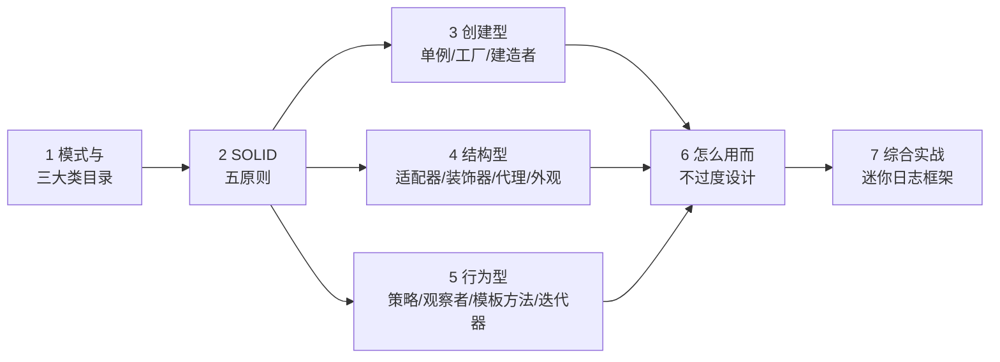

# Java 设计模式：常用模式与 JDK 里的影子

> 📚 **来源与核查**：本篇模式目录与三大类意图依据 [Refactoring Guru 设计模式目录](https://refactoring.guru/design-patterns/catalog)（中文站 [refactoringguru.cn](https://refactoringguru.cn/design-patterns/catalog)），SOLID 依据 [refactoringguru.cn 首页课程范围](https://refactoringguru.cn)，JDK 中模式的例证依据 [JavaGuide《Java IO 基础》](https://javaguide.cn/java/io/io-basis.html)（缓冲流的装饰器）、[JavaGuide《Java 基础》](https://javaguide.cn/java/basis/java-basic-questions-01.html)（Integer.valueOf 缓存）、[JavaGuide《并发》](https://javaguide.cn/java/concurrent/java-concurrent-questions-02.html)（DCL 单例）。核查日期 **2026-10-25**。示例环境：Windows 11 + JDK 21。

设计模式（design pattern）是软件设计中常见问题的典型解决方案——Refactoring Guru 的比喻是「一张可以定制的蓝图」。它不是背 22 个名字，而是学会识别「我遇到的问题属于哪一类」，套用前人验证过的结构。本篇取 Java 工程里出场率最高的一批：创建型 3 个、结构型 4 个、行为型 4 个，每个都配 JDK 里的影子或最小代码，最后用一个迷你日志框架把三个模式串起来。

前置：[02_面向对象.md](02_面向对象.md)（继承、多态、接口是模式的全部地基）、[05_并发编程.md](05_并发编程.md)（单例的 volatile 一节）。

## 🧭 课程地图



一句话路线：先认识地图与原则（1→2），三类模式按「怎么创建、怎么组装、怎么协作」展开（3→5），第 6 节泼一盆冷水防滥用，实战收束（7）。

## 📖 1. 模式是什么：三大类与 22 个模式

Refactoring Guru 的目录把 22 个模式按**意图**分三类（分类意图为目录页原文口径）：

| 类别 | 意图 | 收录模式 |
|---|---|---|
| 创建型（Creational） | 提供各种**对象创建机制**，提升灵活性与复用 | 工厂方法、抽象工厂、建造者、原型、**单例**（5 个） |
| 结构型（Structural） | 说明如何把对象和类**组装成更大的结构**，同时保持灵活高效 | 适配器、桥接、组合、**装饰器**、外观、享元、**代理**（7 个） |
| 行为型（Behavioral） | 关注**算法与对象间职责分配** | 责任链、命令、**迭代器**、中介者、备忘录、**观察者**、状态、**策略**、**模板方法**、访问者（10 个） |

一个提醒：模式解决的是**重复出现的设计问题**，不是具体业务问题；同一个问题往往多种模式都能沾边，优先选「让代码更简单」的那个。

❓ **FAQ**

- **Q：为什么常听说 GoF 23 种？** 1995 年《Design Patterns》四人帮（Gang of Four）一书奠定了这套词汇；各目录收录略有出入，本篇跟随 Refactoring Guru 的 22 种口径。
- **Q：必须全学吗？** 不必。高频的 10 个左右覆盖日常 90% 场景，其余在目录里「能查到、认得出」即可。

📝 **自测**

1. 🟢 「保证一个类只有一个实例」属于哪类模式的问题？
   **答案：** 创建型（单例模式）。
2. 🟢 「不改变类的前提下给对象叠加新职责」是哪类意图？
   **答案：** 结构型（装饰器模式）。
3. 🟡 三大类的关键词分别是什么？
   **答案：** 创建 = 怎么造对象；结构 = 怎么组装成大结构；行为 = 怎么分配职责/协作。

## 📖 2. SOLID 五原则

SOLID 是模式背后的**设计原则**（refactoringguru.cn 官网课程即含 SOLID 内容），比模式更根本——违反它的代码往往散发出「坏味道」：

| 字母 | 原则 | 一句话理解 |
|---|---|---|
| S | 单一职责（Single Responsibility） | 一个类只做一件事，只有一个变化的理由 |
| O | 开闭（Open/Closed） | 对扩展开放、对修改关闭——加功能靠新增代码而非改老代码 |
| L | 里氏替换（Liskov Substitution） | 子类必须能无痛替换父类，不破坏调用方预期 |
| I | 接口隔离（Interface Segregation） | 不强迫实现者实现用不到的方法，接口要小而专 |
| D | 依赖倒置（Dependency Inversion） | 高层模块依赖抽象（接口）而非具体实现 |

```java
// 开闭原则示意：加新形状不需要改 totalArea() —— 与 [02_面向对象.md] 多态一节呼应
double totalArea(List<Shape> shapes) {     // 依赖抽象 Shape
    double sum = 0;
    for (Shape s : shapes) sum += s.area(); // 新形状只需新增子类
    return sum;
}
```

> 💡 **技巧｜原则是方向，不是法律**
> SOLID 用来诊断「为什么改代码这么疼」，不必逐条教条化执行——五个全占满的代码也可能过度设计。

❓ **FAQ**

- **Q：原则和模式什么关系？** 原则是「为什么这样设计好」，模式是「具体怎么摆这些类」；模式是原则在常见场景下的落地形态。
- **Q：依赖倒置「倒置」了什么？** 依赖方向从「高层 → 具体实现」倒置为「高层 → 抽象 ← 具体实现」，细节依赖抽象。

📝 **自测**

1. 🟢 「加功能不改老代码」指哪条原则？
   **答案：** 开闭原则（Open/Closed）。
2. 🟡 子类重写后改变了父类方法的预期行为（如父类约定「相加返回正数」），违反哪条？
   **答案：** 里氏替换原则。
3. 🟢 一个类既算工资又发邮件还导出报表，首先违反？
   **答案：** 单一职责原则（三个变化的理由）。

## 📖 3. 创建型：单例、工厂方法、建造者

**单例（Singleton）**——保证一个类只有一个实例，并提供全局访问点。Java 里三种经典写法：

```java
// 1. 饿汉式：类加载即创建，天生线程安全；缺点是不管用不用都占内存
class Singleton1 {
    private static final Singleton1 INSTANCE = new Singleton1();
    private Singleton1() {}                      // 私有构造器是所有单例的前提
    public static Singleton1 getInstance() { return INSTANCE; }
}

// 2. 枚举：《Effective Java》推崇的单例写法（防反射/防序列化破坏）
enum Singleton2 { INSTANCE; }

// 3. 双重检验锁（DCL）：懒加载 + 线程安全；注意 volatile 不可少！
class Singleton3 {
    private static volatile Singleton3 instance;   // volatile：防重排，见 [05_并发编程.md]
    private Singleton3() {}
    public static Singleton3 getInstance() {
        if (instance == null) {                    // 第一查：避免每次都进同步块
            synchronized (Singleton3.class) {
                if (instance == null) {            // 第二查：排队后再确认一次
                    instance = new Singleton3();
                }
            }
        }
        return instance;
    }
}
```

**工厂方法（Factory Method）**——在父类/接口中定义创建对象的流程，把「具体造哪个」延迟到子类/实现。JDK 影子：`Integer.valueOf(127)` 返回缓存对象而不是 new（[01_基础入门.md](01_基础入门.md) 第 4 节），`List.of(...)`、`Map.of(...)` 这类静态工厂方法——调用方不关心、也不必关心背后 new 了什么。

```java
interface Transport { void deliver(); }
class Truck implements Transport { public void deliver() { System.out.println("公路运输"); } }
class Ship  implements Transport { public void deliver() { System.out.println("海运"); } }

Transport create(String type) {          // 工厂：把 new 收拢到一处
    return switch (type) {
        case "road" -> new Truck();
        case "sea"  -> new Ship();
        default -> throw new IllegalArgumentException("未知类型：" + type);
    };
}
```

**建造者（Builder）**——把复杂对象的构造拆成一环环可读的链式步骤，避免「一长串位置参数」。JDK 影子：`StringBuilder`（一步步 append 最后 toString 产出一个 String）、`Stream.Builder`（add…build 产出一个 Stream）。

```java
class HttpRequest {                        // 一长串可选参数的典型场景
    private final String url; private final int timeout; private final boolean json;
    private HttpRequest(Builder b) { url = b.url; timeout = b.timeout; json = b.json; }
    static Builder builder(String url) { return new Builder(url); }

    static class Builder {
        private final String url; private int timeout = 3000; private boolean json = true;
        Builder(String url) { this.url = url; }
        Builder timeout(int t) { this.timeout = t; return this; }   // 链式返回 this
        Builder asForm()   { this.json = false; return this; }
        HttpRequest build() { return new HttpRequest(this); }
    }
}
// 用法：每个参数都有名字，顺序无关，可读性碾压位置参数
HttpRequest req = HttpRequest.builder("https://api.example.com")
        .timeout(5000)
        .asForm()
        .build();
```

> ⚠️ **常见坑｜单例忘了私有构造器**
> 现象：外面 `new` 得飞起，「单例」名存实亡。原因：构造器默认 public。做法：所有单例写法第一行都是 `private` 构造器；DCL 还要记得 `volatile`（JavaGuide 口径：防「分配-初始化-赋引用」重排后别的线程拿到半成品）。

❓ **FAQ**

- **Q：饿汉、DCL、枚举怎么选？** 默认枚举（最安全）；需要懒加载且不在意复杂度用 DCL；实例很轻、启动就能确定用饿汉也行。
- **Q：工厂模式的价值到底在哪？** 把「创建」从「使用」中剥离：调用方依赖接口，新增实现不改调用代码（开闭原则落地）。

📝 **自测**

1. 🟢 DCL 单例中 volatile 防的是什么问题？
   **答案：** 指令重排导致其他线程拿到「已分配内存但未初始化完成」的对象。
2. 🟡 「构造参数多、可选参数多、易传错位」适合哪个模式？
   **答案：** 建造者（链式命名参数）。解析：想用「多个重载构造器」硬顶是新手常见选择——参数类型相同时传错位编译器根本发现不了。
3. 🟢 工厂方法让「创建」发生了什么变化？
   **答案：** 从调用方直接 new，变为交给工厂决定具体类型；调用方只依赖抽象。

## 📖 4. 结构型：适配器、装饰器、代理、外观

**适配器（Adapter）**——把一个接口转换成调用方期待的另一个接口，让不兼容的类合作。JDK 影子：`InputStreamReader` 被 JavaGuide 定义为「**字节流转换为字符流的桥梁**」——Reader 接口的调用方，背后其实是字节流在干活，这就是适配（详见 [04_java-io.md](04_java-io.md) 第 3 节）。

```java
interface UsbPort { void charge(); }
class TypeCPlug { public void powerOn() { System.out.println("Type-C 通电"); } }

class TypeCToUsbAdapter implements UsbPort {      // 适配器：包住被适配者
    private final TypeCPlug plug;
    TypeCToUsbAdapter(TypeCPlug plug) { this.plug = plug; }
    @Override public void charge() { plug.powerOn(); }   // 接口翻译
}
```

**装饰器（Decorator）**——不修改原类、不继承，通过「包一层同接口对象」动态叠加职责。JDK 影子（JavaGuide 原文）：`BufferedInputStream`/`BufferedOutputStream` **采用装饰器模式增强功能**——它和 FileInputStream 是同接口的兄弟而非父子，套上去就多一层缓冲（[04_java-io.md](04_java-io.md) 第 4 节）。装饰器与代理的代码形态几乎一样（都是「持有接口对象 + 实现同接口」），区别在**意图**：装饰器为「加功能」，代理为「控制访问」。

```java
interface Logger { void log(String msg); }
class ConsoleLogger implements Logger {                       // 被装饰的原始对象
    public void log(String msg) { System.out.println(msg); }
}
class TimestampDecorator implements Logger {                 // 装饰器 A：加时间戳
    private final Logger inner;
    TimestampDecorator(Logger inner) { this.inner = inner; }
    public void log(String msg) { inner.log(java.time.LocalTime.now() + " | " + msg); }
}
class UpperCaseDecorator implements Logger {                 // 装饰器 B：转大写
    private final Logger inner;
    UpperCaseDecorator(Logger inner) { this.inner = inner; }
    public void log(String msg) { inner.log(msg.toUpperCase()); }
}
// 任意叠加、任意顺序：
Logger logger = new TimestampDecorator(new UpperCaseDecorator(new ConsoleLogger()));
```

**代理（Proxy）**——给目标对象提供一个「替身」，在访问前后插入控制逻辑（权限校验、懒加载、远程调用、缓存）。静态代理写法与装饰器同构：

```java
interface UserService { void delete(int id); }
class UserServiceImpl implements UserService {
    public void delete(int id) { System.out.println("删除用户 " + id); }
}
class UserServiceProxy implements UserService {             // 代理：控制访问
    private final UserServiceImpl target = new UserServiceImpl();
    public void delete(int id) {
        if (!currentUserIsAdmin()) throw new SecurityException("无权限"); // 前置控制
        target.delete(id);
    }
    boolean currentUserIsAdmin() { return false; }   // 演示：当前用户非管理员 → 删除请求一律被拦下
}
```

JDK 还内置了基于接口的**动态代理**（运行时生成代理类，AOP 框架的基石），具体 API 用法本篇不展开。待验证: `java.lang.reflect.Proxy`/`InvocationHandler` 的方法签名与用法（使用前请查 [官方反射教程](https://docs.oracle.com/javase/tutorial/reflect/index.html)）。

**外观（Facade）**——给复杂子系统一个统一的高层入口，调用方不用认识子系统里的十几个类。日常例子：一个 `restartServer()` 方法内部编排「断流 → 清缓存 → 起服务 → 健康检查」四个子模块，调用方只见一个门面方法。

> ⚠️ **常见坑｜把装饰器写成继承**
> 现象：想给流加三层能力，写了三层子类，组合数爆炸（A×B×C 三种能力要 7 个子类）。原因：继承在**编译期**静态定型，无法运行时自由组合。做法：装饰器同接口包装，几种装饰器可以任意嵌套、顺序自定。

❓ **FAQ**

- **Q：适配器和装饰器都「包一层」，怎么分？** 适配器改变**接口**（Type-C 变 USB）；装饰器**保持接口**、只加职责（流还是流，多了缓冲）。
- **Q：代理和装饰器怎么分？** 看意图：控制访问（权限/懒加载/远程）是代理；增强功能（时间戳/缓冲/压缩）是装饰器。形态可以完全一样。

📝 **自测**

1. 🟢 BufferedInputStream 用了什么模式？
   **答案：** 装饰器模式（JavaGuide 原文口径）。
2. 🟡 「让 Reader 接口的用户能读字节流」的 InputStreamReader 扮演什么角色？
   **答案：** 适配器（接口转换的桥梁）。
3. 🟡 想在方法调用前加权限校验，代理还是装饰器？
   **答案：** 代理（控制访问意图）。
4. 🟢 给复杂子系统一个统一入口是哪个模式？
   **答案：** 外观（Facade）。

## 📖 5. 行为型：策略、观察者、模板方法、迭代器

**策略（Strategy）**——把一族可互换的算法各自封装，运行时挑选。JDK 影子：`Comparator` 就是一族排序策略，`list.sort(comparingByValue)` 传不同比较器即换策略（[03_集合框架.md](03_集合框架.md) 实战用过）；`ThreadPoolExecutor` 的 `RejectedExecutionHandler`（四种拒绝策略，见 [05_并发编程.md](05_并发编程.md)）同样是「可替换的行为族」。

```java
interface DiscountStrategy { double apply(double price); }
class NoDiscount implements DiscountStrategy { public double apply(double p) { return p; } }
class VipDiscount  implements DiscountStrategy { public double apply(double p) { return p * 0.8; } }
class FullReduce  implements DiscountStrategy { public double apply(double p) { return p >= 100 ? p - 20 : p; } }

double checkout(double price, DiscountStrategy strategy) {   // 高层只依赖抽象
    return strategy.apply(price);
}
```

**观察者（Observer）**——一对多依赖：被观察者状态变化时自动通知所有订阅者。事件监听、消息订阅的骨架：

```java
import java.util.ArrayList;
import java.util.List;

interface Observer { void onEvent(String msg); }
class Publisher {                                   // 被观察者
    private final List<Observer> observers = new ArrayList<>();
    void subscribe(Observer o) { observers.add(o); }
    void publish(String msg) { for (Observer o : observers) o.onEvent(msg); }
}
Publisher p = new Publisher();
p.subscribe(m -> System.out.println("邮件通知：" + m));
p.subscribe(m -> System.out.println("短信通知：" + m));
p.publish("订单已发货");   // 两个订阅者各自收到
```

**模板方法（Template Method）**——父类定好算法骨架（步骤顺序固定），把某几步留成抽象方法交给子类填空：

```java
abstract class ReportGenerator {
    // 模板方法：final 防子类改流程
    public final void generate() {
        fetchData();        // 步骤固定
        String body = render();  // 步骤可变：子类实现
        save(body);         // 步骤固定
    }
    private void fetchData() { System.out.println("从数据库取数"); }
    private void save(String b) { System.out.println("写出报表：" + b); }
    protected abstract String render();            // 留给子类的「空」
}
class HtmlReport extends ReportGenerator {
    @Override protected String render() { return "<table>…</table>"; }
}
```

**迭代器（Iterator）**——提供顺序遍历聚合对象元素的统一方式，不暴露内部结构。JDK 影子最彻底：`Collection` 继承 `Iterable`，`for (String s : list)` 就是编译器按迭代器协议展开的语法糖（第 5 节 fail-fast 讲的正是迭代器的行为，见 [03_集合框架.md](03_集合框架.md)）。

❓ **FAQ**

- **Q：策略模式和「一堆 if-else」差在哪？** if-else 把所有分支焊死在一个方法里（改一处动全身）；策略把每个分支变成独立类，新增策略 = 新增类，符合开闭原则。
- **Q：模板方法里的钩子是什么？** 骨架中「有默认实现、子类可选择性覆盖」的方法，比纯抽象方法更灵活。

📝 **自测**

1. 🟢 JDK 里 `Comparator` 扮演的角色？
   **答案：** 策略（一族可替换的排序算法）。
2. 🟡 「订阅-通知」一对多是哪个模式？
   **答案：** 观察者。
3. 🟡 父类固定流程、子类填空，是哪个模式？
   **答案：** 模板方法。
4. 🟢 for-each 循环依赖哪个模式提供的协议？
   **答案：** 迭代器（Iterable/Iterator）。

## 📖 6. 怎么用而不过度设计

模式是药，对症才吃。三条纪律：

1. **从痛点出发，不从目录出发**。先有「这段代码为什么难改」的诊断（改一处牵十处 → 策略/开闭；参数越加越多 → 建造者），再找模式；反过来「学了个模式找地方用」必然过度设计。
2. **先简单后模式**。能一个函数解决的，不要三个类 + 两个接口；模式每个都有「类的数量、间接层」的代价。
3. **给模式配反例**：单例变成「全局变量」被四处调用（隐藏依赖、难测试）；到处是只有一层实现的接口（为抽象而抽象）；观察者满天飞导致事件流向不可追。

选型速查（场景 → 首先想到谁）：

| 你遇到的问题 | 先想到 |
|---|---|
| 全局只要一个实例 | 单例 |
| 创建逻辑复杂/需收拢/需解耦 | 工厂方法 |
| 可选参数多、构造器重载爆炸 | 建造者 |
| 接口不匹配要「翻译」 | 适配器 |
| 运行时叠加/组合功能 | 装饰器 |
| 控制对对象的访问（权限/懒加载） | 代理 |
| 子系统太碎，给个总入口 | 外观 |
| 一族可互换算法/规则 | 策略 |
| 状态变化要广播多个相关方 | 观察者 |
| 流程固定、个别步骤可变 | 模板方法 |

❓ **FAQ**

- **Q：面试聊模式怎么组织回答？** 结构：模式名 → 意图一句话 → 场景例子（最好 JDK 里或你项目里的）→ 代价与替代方案。有代价意识（第 3 点）的回答远胜背 UML。
- **Q：Spring 里到处是模式，要专门学吗？** 本系列不涉框架；有了本篇词汇（代理/工厂/模板方法/观察者），读框架文档时自然能对号入座。

📝 **自测**

1. 🟡 团队代码评审时看到「一个只有唯一实现的接口，且无人预期会有第二实现」，该提什么意见？
   **答案：** 过度抽象——除非有明确扩展点需求，删掉接口直接用类（YAGNI/避免为抽象而抽象）。
2. 🟢 模式滥用的共同症状是什么？
   **答案：** 类和间接层暴涨，但变化并没有被隔离——改需求时还是要动很多文件。

## 🚀 7. 综合实战：迷你日志框架

一个可运行的小项目串起三种模式：**单例**管全局 Logger，**策略**切换输出目的地，**装饰器**叠加格式处理。这正是 java.io「流套流」思想的复刻。

```java
import java.io.PrintWriter;
import java.time.LocalTime;
import java.util.ArrayList;
import java.util.List;

// ===== 策略：输出目的地可替换 =====
interface OutputStrategy { void write(String line); }
class ConsoleOutput implements OutputStrategy {
    public void write(String line) { System.out.println(line); }
}
class FileOutput implements OutputStrategy {
    private final PrintWriter writer;
    FileOutput(String path) {
        try { this.writer = new PrintWriter(path, "UTF-8"); }
        catch (Exception e) { throw new RuntimeException(e); }
    }
    public void write(String line) { writer.println(line); writer.flush(); }
}

// ===== 装饰器：给任意目的地叠加能力 =====
abstract class OutputDecorator implements OutputStrategy {
    protected final OutputStrategy inner;
    protected OutputDecorator(OutputStrategy inner) { this.inner = inner; }
}
class TimestampedOutput extends OutputDecorator {                 // 加时间戳
    TimestampedOutput(OutputStrategy inner) { super(inner); }
    public void write(String line) { inner.write(LocalTime.now() + " | " + line); }
}
class LeveledOutput extends OutputDecorator {                     // 加级别过滤
    private final String level;
    LeveledOutput(OutputStrategy inner, String level) { super(inner); this.level = level; }
    public void write(String line) { inner.write("[" + level + "] " + line); }
}

// ===== 单例：全局唯一入口（枚举实现） =====
enum MiniLogger {
    INSTANCE;
    private final List<OutputStrategy> outputs = new ArrayList<>();
    public void bind(OutputStrategy out) { outputs.add(out); }
    public void info(String msg) {
        for (OutputStrategy o : outputs) o.write(msg);            // 观察者式的扇出
    }
}

public class LogDemo {
    public static void main(String[] args) {
        OutputStrategy console = new TimestampedOutput(new ConsoleOutput());
        OutputStrategy file = new LeveledOutput(
                new TimestampedOutput(new FileOutput("app.log")), "INFO");
        MiniLogger.INSTANCE.bind(console);   // 策略一：控制台
        MiniLogger.INSTANCE.bind(file);      // 策略二：文件（装饰器两层叠加）
        MiniLogger.INSTANCE.info("服务启动完成");
        MiniLogger.INSTANCE.info("处理订单 #1024");
    }
}
```

动手改造（每一条练一个模式）：① 新增 `JsonOutput` 策略把日志写成 JSON 行；② 新增 `ThreadIdDecorator` 打印线程名（注意 try-finally 与 [05_并发编程.md](05_并发编程.md) 的 ThreadLocal 可以配合传 traceId）；③ 把 `MiniLogger` 从枚举改成 DCL 单例，对比两种写法；④ 给 `OutputStrategy` 加 `close()` 并用 try-with-resources 管理（[04_java-io.md](04_java-io.md) 第 6 节）。

## 📚 8. 来源与进一步学习

- [Refactoring Guru：设计模式目录（英文）](https://refactoring.guru/design-patterns/catalog)／[中文站目录](https://refactoringguru.cn/design-patterns/catalog)（22 模式三大类及各模式详解页，含 Java 示例）——核查 2026-10-25
- [refactoringguru.cn 首页](https://refactoringguru.cn)（免费中文教程：设计模式、重构、SOLID）——核查 2026-10-25
- JDK 例证：[JavaGuide IO 基础](https://javaguide.cn/java/io/io-basis.html)（缓冲流装饰器）、[JavaGuide 并发（中）](https://javaguide.cn/java/concurrent/java-concurrent-questions-02.html)（DCL 与 volatile）、[JavaGuide 基础（上）](https://javaguide.cn/java/basis/java-basic-questions-01.html)（Integer 缓存）——核查 2026-10-25
- 进阶书：《Effective Java》《Head First 设计模式》；下一篇：[08_常用工具类.md](08_常用工具类.md)
