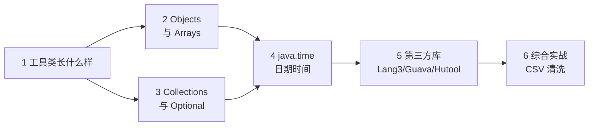

# Java 常用工具类：从 java.util 到第三方库

> 📚 **来源与核查**：本篇依据 [Arrays 官方 Javadoc（Java SE 21）](https://docs.oracle.com/en/java/javase/21/docs/api/java.base/java/util/Arrays.html)、[HashMap Javadoc](https://docs.oracle.com/en/java/javase/21/docs/api/java.base/java/util/HashMap.html)（Collections.synchronizedMap）、[Apache Commons Lang3 官方 API](https://commons.apache.org/proper/commons-lang/apidocs/org/apache/commons/lang3/package-summary.html)、社区工具类综述（[CSDN：Java 常用工具类库](https://blog.csdn.net/m0_37583655/article/details/118400750)、[博客园：commons/guava/hutool 使用](https://www.cnblogs.com/qlqwjy/p/9467178.html)）整理，核查日期 **2026-10-25**。示例环境：Windows 11 + JDK 21。

日常 Java 代码里，一半的行数其实在调用工具方法：判空、数组拷贝排序、日期格式化、字符串拼接。这些轮子 JDK 和社区早就造好了，自己手写既是浪费，也容易写出 bug。本篇分三层讲：**JDK 自带（Objects/Arrays/Collections/Optional/java.time）→ 字符串拼接利器 → 第三方库（Commons Lang3、Guava、Hutool）**，最后用一个 CSV 清洗小工具收束。完成后你知道「遇到 X 该调哪个方法」，不用再手写循环。

前置：[01_基础入门.md](01_基础入门.md)、[03_集合框架.md](03_集合框架.md)（集合操作是工具方法的主战场）。

## 🧭 课程地图



一句话路线：先认识「工具类 = 私有构造 + 静态方法」这个形态（1），再按使用频率过 JDK 自带四件套（2→4），第三方库是「更强的同款」（5），实战全串（6）。

## 📖 1. 工具类长什么样

工具类（utility class）= 一组**静态方法**的集合，没有实例状态——`java.util.Objects`、`java.util.Arrays`、`java.util.Collections`、`Integer` 的 parse 系列都是这个形态。两个约定俗成的特征：

1. 方法全是 `static`，用类名直接调用（`Objects.equals(a, b)`）；
2. 构造器私有（防止别人 `new` 一个没意义的东西）。

```java
public class MyUtils {
    private MyUtils() {}                       // 工具类标准姿势：私有构造器

    public static boolean isBlank(String s) {
        return s == null || s.isBlank();
    }
}
```

> 💡 **技巧｜写工具方法前先找现成的**
> 动手造轮子前，按顺序查三处：JDK 自带（本篇 2~4 节）→ 所用框架的 utils 包 → 第三方库（第 5 节）。绝大多数「字符串/数组/集合/日期」的常见需求都已有一行式答案。

❓ **FAQ**

- **Q：静态方法多了会不会「工具类万金油化」？** 会，这是常见反模式——一个千行 Utils 啥都塞。按主题拆分（StringUtils、DateUtils、JsonUtils……），别让一个类变成垃圾场。
- **Q：工具方法和 Stream / lambda 怎么配合？** 工具方法处理「单一确定的小事」，Stream 描述「对集合的流水线加工」，常常组合使用（见第 6 节实战）。

📝 **自测**

1. 🟢 工具类的两个标配特征？
   **答案：** 全静态方法 + 私有构造器。
2. 🟢 `Objects`、`Arrays`、`Collections` 三个类能否 new？
   **答案：** 不能（构造器私有），设计上也无意义。

## 📖 2. Objects 与 Arrays

**`java.util.Objects`**——对象操作三件套（社区综述的概括：判空、equals、hash）：

```java
Objects.requireNonNull(user, "user 不能为空");   // 参数校验：null 直接抛 NPE 并带消息
Objects.equals(a, b);    // null 安全的相等比较：两者皆 null 也返回 true，不怕任何一边是 null
Objects.hash(x, y, z);   // 基于多字段算 hash——[02_面向对象.md] 重写 hashCode 用的就是它
Objects.isNull(o);       // 等价于 o == null，主要价值是在流里当谓词用
```

与 `a.equals(b)` 的区别：一旦 `a` 是 null，直接抛 `NullPointerException`；`Objects.equals` 把 null 当作一种正常取值处理。

**`java.util.Arrays`**——数组操作全家桶（Javadoc 口径）：

| 方法 | 作用（Javadoc 原文口径） |
|---|---|
| `asList(T... a)` | **"Returns a fixed-size list backed by the specified array"**：定长列表视图，改元素写回原数组，`add`/`remove` 抛 UnsupportedOperationException |
| `sort` | 升序排序：基本类型用 Dual-Pivot 快排；对象用 **TimSort**（稳定排序，相等元素不换位） |
| `binarySearch` | **必须先排序**；找到返回下标，未找到返回 `-(插入点) - 1` |
| `copyOf` / `copyOfRange` | 复制（截断或补零）；ArrayList 扩容底层就是它（[03_集合框架.md](03_集合框架.md)） |
| `fill` / `toString` / `equals` / `stream` | 填充 / 内容转字符串 / 内容比较 / 转流 |

```java
int[] arr = {3, 1, 2};
Arrays.sort(arr);                          // [1, 2, 3]
int i = Arrays.binarySearch(arr, 2);       // 1（下标）
int j = Arrays.binarySearch(arr, 4);       // -4：-(插入点3) - 1

System.out.println(arr);                   // [I@1b6d3586 之类——Object 默认 toString（类名@十六进制哈希）
System.out.println(Arrays.toString(arr));  // [1, 2, 3] —— 打印数组永远用它

List<Integer> view = Arrays.asList(1, 2, 3);
view.set(0, 99);                           // OK，写回底层数组
// view.add(4);                            // UnsupportedOperationException！定长
```

> ⚠️ **常见坑｜Arrays.asList 之后 add/remove**
> 现象：运行时抛 `UnsupportedOperationException`。原因：asList 返回的是「数组的定长视图」，不是完整 List（Javadoc 明示 fixed-size ... backed by）。做法：需要增删就再包一层 `new ArrayList<>(Arrays.asList(arr))`（复制出可变列表）。

> ⚠️ **常见坑｜binarySearch 用在未排序数组上**
> 现象：返回值「时对时错」。原因：二分查找的前提是有序（Javadoc 明确要求先排序）。做法：先 `Arrays.sort` 再查；查不到时返回的负数编码了插入点信息。

❓ **FAQ**

- **Q：为什么 `Arrays.equals(a, b)` 和 `a.equals(b)` 结果不同？** 数组本身没有重写 equals（用的还是 Object 的「同对象才相等」）；`Arrays.equals` 逐元素比较内容，`Arrays.deepEquals` 还能比较多维数组。
- **Q：`Objects.requireNonNull` 比 `if (x == null) throw ...` 好在哪？** 一行完成「判空 + 抛异常 + 带消息」，是标准库与开源代码里的高频习惯写法。

📝 **自测**

1. 🟢 打印数组内容用哪个方法？
   **答案：** `Arrays.toString(arr)`（直接 println 得到的是 Object 默认格式「类名@哈希」）。解析：以为会自动打印内容的同学是被字符串的友好输出惯坏了——数组没重写 toString。
2. 🟡 `Arrays.asList` 返回的 List 能 add 吗？
   **答案：** 不能（定长视图，add/remove 抛 UnsupportedOperationException；set 可以）。
3. 🟡 binarySearch 未命中时的返回值规律？
   **答案：** `-(插入点) - 1`（负数且不与任何合法下标冲突）。

## 📖 3. Collections 与 Optional

**`java.util.Collections`**——集合的静态工具（与 Collection 接口一对「接口/工具类」）。最值得记住的三类：

```java
Map<String, Integer> sync = Collections.synchronizedMap(new HashMap<>()); // 同步包装（HashMap Javadoc 给出的官方做法）
List<String> frozen = Collections.unmodifiableList(List.of("a", "b"));    // 只读视图：改它抛 UnsupportedOperationException
Collections.reverse(list);     // 原地反转
Collections.sort(list);        // 排序（日常更常用 list.sort(comparator) 的实例写法）
```

配套常识：需要线程安全的 Map，优先 `ConcurrentHashMap`（[03_集合框架.md](03_集合框架.md) 第 3 节），`synchronizedMap` 多用于兼容旧代码；需要「防改」的数据出口，unmodifiable 系列比复制一份便宜。

**`Optional<T>`**——「可能没有值」的显式容器，用来替代「返回 null + 调用方忘记判空」的经典事故链：

```java
import java.util.Optional;

Optional<String> findUser(int id) {
    return id > 0 ? Optional.of("用户" + id) : Optional.empty();
}

String name = findUser(42).orElse("默认名");          // 没有值给默认
String safe  = findUser(-1).orElseGet(() -> "懒计算"); // 没有值才执行 lambda
findUser(1).ifPresent(u -> System.out.println("找到 " + u));
// findUser(1).get();   // 有值返回、空则抛 NoSuchElementException——避免裸 get
```

> ⚠️ **常见坑｜把 Optional 用在字段或参数上**
> 现象：类里 `Optional<User> user` 字段、方法签名 `void save(Optional<User> u)`。原因：把它当「更高级的 null」到处放。做法：Optional 的设计场景是**方法的返回值**——表达「这次可能查不到」；字段直接可空建模、参数直接传对象并校验更简单。

❓ **FAQ**

- **Q：`orElse` 与 `orElseGet` 的区别？** orElse 的参数**总会被执行**（即使有值）；orElseGet 的 lambda 只在没值时才执行——默认值昂贵时用 orElseGet。
- **Q：Optional 能彻底消灭 NPE 吗？** 消灭的是「返回值 null 未检查」这一类；容器自己也能为 null（`Optional.of` 传 null 直接 NPE，要 null 容忍用 `Optional.ofNullable`）。

📝 **自测**

1. 🟢 表达「方法可能查不到结果」，规范做法是？
   **答案：** 返回 `Optional<T>`（而不是返回 null 让调用方猜）。
2. 🟡 昂贵的默认值计算该用 orElse 还是 orElseGet？
   **答案：** orElseGet（有值时不执行 lambda）。
3. 🟢 旧代码要求线程安全 Map 的官方包装法？
   **答案：** `Collections.synchronizedMap(new HashMap<>())`（新代码优先 ConcurrentHashMap）。

## 📖 4. java.time：日期时间

JDK 8 引入的 `java.time` 包替代了老 `Date`/`Calendar`（社区综述口径：LocalDateTime 等 API 替代旧 Date）。核心类四件：`LocalDate`（日期）、`LocalTime`（时间）、`LocalDateTime`（日期+时间）、`DateTimeFormatter`（格式化/解析）。惯例是小写静态工厂开头：`now` / `of` / `parse`。

```java
import java.time.*;
import java.time.format.DateTimeFormatter;

LocalDate today = LocalDate.now();                    // 2026-10-25（本篇核查日）
LocalDate d = LocalDate.of(2026, 10, 1);
LocalDateTime dt = LocalDateTime.now();

// 运算返回新对象（不改原对象）
LocalDate nextWeek = today.plusWeeks(1);
LocalDate deadline = today.plusDays(3).withDayOfMonth(1);

// 格式化与解析（不可变设计，可作共享常量——所以 [05_并发编程.md] 第 6 节里 SimpleDateFormat 才需要 ThreadLocal 每线程一份的旧套路）
DateTimeFormatter fmt = DateTimeFormatter.ofPattern("yyyy/MM/dd HH:mm");
String s = dt.format(fmt);                            // 2026/10/25 14:30
LocalDateTime parsed = LocalDateTime.parse("2026/10/25 14:30", fmt);

// 差值
Period p = Period.between(d, today);                  // 年/月/日差
long days = Duration.between(dt, dt.plusHours(3)).toHours();  // 时间差：3
```

```java
// 与老代码互转（老 API 还活在数据库字段、旧接口里）
Date legacy = Date.from(dt.atZone(ZoneId.systemDefault()).toInstant());
LocalDateTime back = legacy.toInstant().atZone(ZoneId.systemDefault()).toLocalDateTime();
```

> ⚠️ **常见坑｜拿 Date/Calendar 的老经验套 LocalDate**
> 现象：调用 `set`/`add` 想改字段，发现没有这类方法。原因：java.time 的类型不做原地修改，所有运算都返回新对象。做法：接受 `date = date.plusDays(1)` 的赋值风格——不可变带来的线程安全正是它取代老 API 的理由之一。

❓ **FAQ**

- **Q：怎么比较两个 LocalDate 先后？** `isBefore` / `isAfter` / `isEqual`，不要用 `==`（比地址）也不要先格式化成字符串再比（易错且慢）。
- **Q：月份从 0 还是 1 开始？** `LocalDate.of(2026, 10, 1)` 用自然语义 1~12（老 `Calendar` 的 MONTH 从 0 开始是历史坑，java.time 已修正）。

📝 **自测**

1. 🟢 `today.plusDays(1)` 会修改 today 吗？
   **答案：** 不会，返回一个新 LocalDate（不可变风格）。
2. 🟡 线程安全的格式化器用哪个类？
   **答案：** `DateTimeFormatter`（可作共享常量；SimpleDateFormat 非线程安全才需要 ThreadLocal 包装）。
3. 🟢 `LocalDate.of(2026, 10, 25)` 里的 10 是几月？
   **答案：** 十月（1~12 自然语义）。

## 📖 5. 第三方库：Commons Lang3、Guava、Hutool

当 JDK 的工具方法不够顺手时，社区三库接力。引用方式（Maven/Gradle 依赖坐标到 [Maven Central](https://central.sonatype.com/) 搜索最新版本；下表坐标为惯例写法，版本号请以仓库查询为准）：

| 库 | 坐标（查最新版） | 定位 |
|---|---|---|
| Apache Commons Lang3 | `org.apache.commons:commons-lang3` | `java.lang` 的增强版（官方 API 页自述） |
| Google Guava | `com.google.guava:guava` | Google 集合/缓存/并发全家桶 |
| Hutool | `cn.hutool:hutool-all` | 国产「瑞士军刀」，API 中文档全 |

**Commons Lang3** 的招牌是 `StringUtils`——官方 API 文档原话："oodles and oodles of functions"（一大堆字符串处理函数）。最常用的两个判空方法，区别要记牢：

```java
StringUtils.isEmpty(s);   // 只判 null 或 长度 0；"  " 算非空
StringUtils.isBlank(s);   // null / 长度 0 / 全空白都算空；用户输入清洗首选
// 还有 truncate / strip / repeat / swapCase 等大量小函数，需要时查官方 API
```

**Guava** 高频四件（社区综述口径）：

```java
import com.google.common.collect.*;

Lists.newArrayList("a", "b");          // 便捷创建（含带元素重载）
Sets.newHashSet(1, 2, 3);
Multimap<String, Integer> mm = HashMultimap.create();   // 一个 key 多个 value
mm.put("score", 90); mm.put("score", 85);               // score -> [90, 85]

Joiner.on(", ").skipNulls().join("a", null, "c");       // "a, c"
Splitter.on(",").trimResults().omitEmptyStrings().split(" a , , b "); // [a, b]
// 并发方向还有 RateLimiter 限流器（[05_并发编程.md] 的进阶邻居）
```

**Hutool** 一句带过：小工具密度极高（加密、Excel、HTTP、日期一个包全包），个人项目提效明显；团队项目选型时确认大家接受其「大而全」的风格即可（社区综述将其与 commons/guava 并列介绍）。

> ⚠️ **常见坑｜isEmpty 与 isBlank 用反**
> 现象：表单里输入几个空格通过了「非空校验」。原因：isEmpty 认为 `"  "` 非空，只有 isBlank 把纯空白当空。做法：用户输入/外部数据的空值判断统一 isBlank。

❓ **FAQ**

- **Q：JDK 都有 `String.isBlank` 了（JDK 11+），还要 StringUtils 吗？** 判空层面确实大部分可替代；但 null 容忍性不同——`s.isBlank()` 在 s 为 null 时抛 NPE，`StringUtils.isBlank(null)` 返回 true。批量处理可能为 null 的数据时第三方仍省心。
- **Q：三个库都要引吗？** 不要，按需最小引入；团队有既定栈就跟栈（很多项目 Guava 已随框架传递进来）。

📝 **自测**

1. 🟢 `" "`（三个空格）在 isEmpty / isBlank 下分别算什么？
   **答案：** isEmpty：非空；isBlank：空。解析：这是校验逻辑 bug 的头号来源——「视觉上是空的」和「技术上非空」必须分清。
2. 🟡 Guava 里「一个 key 对应多个 value」用什么？
   **答案：** Multimap（`HashMultimap.create()`）。
3. 🟢 判空时第三方 StringUtils 相对 JDK 方法的额外好处？
   **答案：** null 容忍（null 不抛异常，按空处理）。

## 🚀 6. 综合实战：CSV 数据清洗小工具

需求：清洗一箱「姓名,入职日期,分数」的 CSV 行——跳过空行/纯空白行，解析失败记错误原因，输出规整结果。串起：StringUtils.isBlank、StringJoiner、java.time、Objects、集合工具。

```java
import java.time.LocalDate;
import java.time.format.DateTimeFormatter;
import java.util.ArrayList;
import java.util.List;

public class CsvCleaner {

    record Employee(String name, LocalDate hireDate, int score) { }   // 数据载体
    static final DateTimeFormatter FMT = DateTimeFormatter.ISO_LOCAL_DATE;

    public static void main(String[] args) {
        List<String> rows = List.of(
                "张三,2023-05-01,88",
                "   ",                       // 空白行：isBlank 拦截
                "李四,2023-13-99,92",        // 非法日期
                "王五,2024-01-15,75",
                "赵六,2024-02-30,abc"        // 非法分数
        );

        List<Employee> ok = new ArrayList<>();
        List<String> errors = new ArrayList<>();

        for (String row : rows) {
            if (row == null || row.isBlank()) continue;          // StringUtils.isBlank 同款逻辑
            String[] parts = row.split(",");
            if (parts.length != 3) { errors.add("列数不对：" + row); continue; }
            try {
                String name = parts[0].trim();
                LocalDate hire = LocalDate.parse(parts[1].trim(), FMT);   // 非法日期在这里抛异常
                int score = Integer.parseInt(parts[2].trim());           // 非法分数在这里抛异常
                ok.add(new Employee(name, hire, score));
            } catch (Exception e) {
                errors.add(row + " -> " + e.getClass().getSimpleName());
            }
        }

        ok.sort(java.util.Comparator.comparingInt(Employee::score).reversed());
        System.out.println("清洗成功 " + ok.size() + " 条：");
        for (Employee e : ok) {
            StringJoiner sj = new StringJoiner(" | ");
            sj.add(e.name()).add(e.hireDate().toString()).add(String.valueOf(e.score()));
            System.out.println("  " + sj);
        }
        System.out.println("失败 " + errors.size() + " 条：");
        errors.forEach(msg -> System.out.println("  " + msg));
    }
}
```

预期输出：2 条成功（王五、张三按分数降序），2 条失败（日期异常、数字格式异常），1 行被 isBlank 静默跳过。练习：① 换成 `Files.readAllLines` 从真文件读（IO 见 [04_java-io.md](04_java-io.md)）；② 用 Stream `map` + `filter` 重写主循环；③ 引入 Guava 的 `Splitter` 替代 `String.split`，对比对空段的处理。

## 📚 7. 来源与进一步学习

- [Arrays（Java SE 21 Javadoc）](https://docs.oracle.com/en/java/javase/21/docs/api/java.base/java/util/Arrays.html)（asList 定长口径、TimSort、binarySearch 返回值）——核查 2026-10-25
- [HashMap（Java SE 21 Javadoc）](https://docs.oracle.com/en/java/javase/21/docs/api/java.base/java/util/HashMap.html)（Collections.synchronizedMap 官方用法）——核查 2026-10-25
- [Apache Commons Lang3 官方 API：StringUtils](https://commons.apache.org/proper/commons-lang/apidocs/org/apache/commons/lang3/package-summary.html)——核查 2026-10-25
- [CSDN：Java 常用工具类库](https://blog.csdn.net/m0_37583655/article/details/118400750)／[博客园：commons/guava/hutool](https://www.cnblogs.com/qlqwjy/p/9467178.html)（Guava Lists/Joiner/Splitter/Multimap/RateLimiter 例证）——核查 2026-10-25
- 系列回顾：[01_基础入门.md](01_基础入门.md)｜[02_面向对象.md](02_面向对象.md)｜[03_集合框架.md](03_集合框架.md)｜[04_java-io.md](04_java-io.md)｜[05_并发编程.md](05_并发编程.md)｜[06_jvm.md](06_jvm.md)｜[07_设计模式.md](07_设计模式.md)
